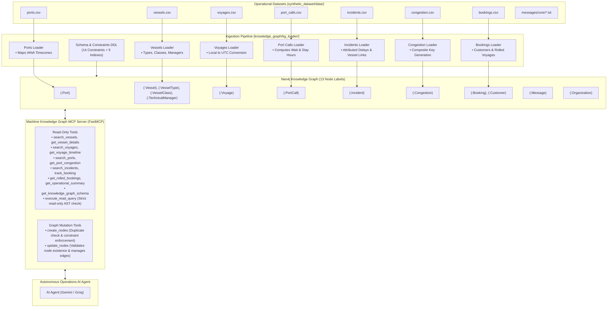

# Maritime Knowledge Graph & Operations Assistant

A production-grade **Neo4j Knowledge Graph** and **Model Context Protocol (FastMCP) Server** designed for maritime fleet intelligence, delay root-cause analysis, and cargo tracking. 

The system standardizes all operational tabular data to UTC, integrates unstructured operational communications, exposes safe multi-hop graph reasoning tools, and provides validated mutation capabilities for incident logging and entity updates.

---

## 1. Architecture Overview



---

## 2. Maritime Knowledge Graph MCP Server

The MCP server exposes high-level, domain-specific tools as well as controlled graph mutation tools to AI agents over standard MCP (stdio / SSE) using **FastMCP**.

### Available MCP Tools

| Tool | Category | Operational Description |
| :--- | :---: | :--- |
| **`create_nodes`** | **Mutation** | Creates new nodes with duplicate validation on primary/unique keys, schema constraint checks, and edge attachment at creation time. |
| **`update_nodes`** | **Mutation** | Exclusively updates existing valid nodes (rejects non-existent nodes); updates attributes and adds/modifies relationships. Returns full 360° connections for agent reasoning. |
| **`execute_read_query`** | **Read-Only** | Executes arbitrary Cypher read queries. Mutating operations (`CREATE`, `MERGE`, `SET`, `DELETE`, etc.) and administrative procedures are strictly blocked. |
| **`get_knowledge_graph_schema`**| **Read-Only** | Returns graph metadata: 13 node labels, relationship types, property keys, and database constraints. |
| **`search_vessels`** | **Read-Only** | Filters vessels by IMO, name, vessel class (*Meridian 8500*, *Atlas 6000*), or type (*Container ship*). |
| **`get_vessel_details`** | **Read-Only** | 360° vessel profile: structural class, technical manager, executed voyages, and historical incidents. |
| **`search_voyages`** | **Read-Only** | Searches voyages with filters for origin, destination, delay hours, and status (*Completed*, *Delayed*, *On schedule*). |
| **`get_voyage_timeline`** | **Read-Only** | Complete voyage transit milestones: local and UTC ETAs, berth windows, anchorage wait hours, and incidents. |
| **`search_ports`** | **Read-Only** | Port lookup by UN/LOCODE, name, country, and native IANA timezone. |
| **`get_port_congestion`** | **Read-Only** | Daily port congestion telemetry: queue counts at anchor, average wait hours, and congestion level. |
| **`search_incidents`** | **Read-Only** | Disruption lookup across voyages and vessels by severity, incident type, status, or source. |
| **`track_booking`** | **Read-Only** | Tracks customer cargo bookings, container volumes, promised delivery dates, and rolled status. |
| **`get_rolled_bookings`** | **Read-Only** | Lists all rolled cargo bookings with original and re-assigned voyage links. |
| **`get_operational_summary`** | **Read-Only** | Executive KPI summary: active fleet vessels, transits, delayed voyages, logged incidents, and rolled containers. |

---

### Running the MCP Server

Start the FastMCP server directly via `uv`:

```powershell
uv run python -m knowledge_graph.maritime_kg_mcp.main
```

Or configure it in your MCP client configuration (e.g. `.agents/mcp_config.json`):

```json
{
  "mcpServers": {
    "maritime-kg": {
      "command": "uv",
      "args": ["run", "python", "-m", "knowledge_graph.maritime_kg_mcp.main"],
      "env": {
        "NEO4J_URI": "bolt://localhost:7687",
        "NEO4J_USER": "neo4j",
        "NEO4J_PASSWORD": "password"
      }
    }
  }
}
```

---

## 3. Ingestion Order & Schema Features

1. **Schema Initialization (`knowledge_graph/kg_loader/schema.py`)**:
   - Applies 14 `CREATE CONSTRAINT ... REQUIRE ... IS UNIQUE` statements across all node identifiers (`vessel_id`, `imo`, `type_id`, `class_id`, `manager_id`, `port_code`, `voyage_id`, `call_id`, `incident_id`, `congestion_id`, `booking_id`, `customer_id`, `org_id`, `message_id`).
   - Applies performance indexes on high-frequency query timestamps (`revised_eta_utc`, `reported_utc`, `date_utc`, `promised_delivery_date_utc`, `sent_at_utc`).

2. **Ports (`ports.csv`)**:
   - Creates `(:Port {port_code, name, country, timezone})`.
   - Builds port timezone mapping for downstream UTC normalization.

3. **Fleet & Classification (`vessels.csv`)**:
   - Creates `(:Vessel)`, `(:VesselType)`, `(:VesselClass)`, and `(:TechnicalManager)`.
   - Establishes relationships `[:OF_TYPE]`, `[:OF_CLASS]`, and `[:MANAGED_BY]`.

4. **Voyages (`voyages.csv`)**:
   - Converts origin `departure_local` to `departure_utc` using origin port IANA timezone.
   - Converts destination `original_eta_local`, `revised_eta_local`, `berth_window_start_local`, and `berth_window_end_local` to UTC using destination port timezone.
   - Establishes relationships `(:Vessel)-[:OPERATES_VOYAGE]->(:Voyage)`, `(:Voyage)-[:DEPARTS_FROM]->(:Port)`, and `(:Voyage)-[:ARRIVES_AT]->(:Port)`.

5. **Port Calls (`port_calls.csv`)**:
   - Ingests milestone timestamps (`anchorage_arrival_utc`, `berth_scheduled_utc`, `berthing_utc`, `departure_utc`).
   - Computes `anchorage_wait_hours` (`berthing - arrival`) and `port_stay_hours` (`departure - berthing`).
   - Links `(:Voyage)-[:HAS_PORT_CALL]->(:PortCall)`, `(:PortCall)-[:AT_PORT]->(:Port)`, and `(:PortCall)-[:CALL_BY]->(:Vessel)`.

6. **Incidents (`incidents.csv`)**:
   - Ingests disruption records with `reported_utc` and `attributed_delay_hours`.
   - Links `(:Voyage)-[:EXPERIENCED_INCIDENT]->(:Incident)` and derived shortcut `(:Incident)-[:AFFECTS_VESSEL]->(:Vessel)`.

7. **Congestion (`congestion.csv`)**:
   - Generates composite primary key `CONG_<port>_<date>` (e.g. `CONG_SGSIN_2026-09-17`).
   - Links `(:Port)-[:HAS_CONGESTION]->(:Congestion)`.

8. **Bookings & Customers (`bookings.csv`)**:
   - Creates `(:Customer)` and `(:Booking)`.
   - Sets `is_rolled` boolean and links `(:Booking)-[:BOOKED_ON]->(:Voyage)`.
   - If cargo is rolled to an explicit voyage (e.g. `Rolled to VG-1107`), creates `(:Booking)-[:ROLLED_TO]->(:Voyage)`.

---

## 4. Directory Layout

```
maritime-assistant/
├── knowledge_graph/
│   ├── config.py                       # Configuration & path resolvers
│   ├── database.py                     # Neo4j client & session execution
│   ├── kg_loader/                      # Ingestion pipeline & normalizers
│   │   ├── main.py                     # CLI ingestion entrypoint
│   │   ├── pipeline.py                 # Pipeline orchestrator
│   │   ├── schema.py                   # Constraints & index DDL
│   │   ├── normalizers.py              # UTC timezone & duration converters
│   │   └── loaders/                    # Modular CSV table loaders
│   ├── maritime_kg_mcp/                # FastMCP Knowledge Graph Server
│   │   ├── main.py                     # MCP Server CLI entrypoint
│   │   ├── server.py                   # FastMCP instance & tool registrations
│   │   ├── security.py                 # Read-only Cypher AST parser & validator
│   │   └── tools/                      # Domain-specific MCP tool implementations
│   │       ├── cypher_tool.py          # Validated Cypher runner
│   │       ├── schema_tool.py          # Dynamic graph schema inspector
│   │       ├── vessel_tools.py         # Fleet & vessel profile search
│   │       ├── voyage_tools.py         # Voyage transit & timeline queries
│   │       ├── port_tools.py           # Port and congestion telemetry
│   │       ├── incident_tools.py       # Operational disruptions & defects
│   │       ├── booking_tools.py        # Cargo bookings & rolled containers
│   │       ├── summary_tool.py         # High-level operational KPIs
│   │       └── node_tools.py           # create_nodes & update_nodes mutations
│   └── design/
│       └── kg_schema_design.md         # Domain Knowledge Graph schema specification
│
├── synthetic_dataset/                  # Operational test data (CSVs & messages)
│   └── data/
│
├── tests/
│   ├── test_ingestion.py               # Unit tests for normalizers & loaders
│   └── test_mcp.py                     # Unit tests for MCP tools & security
│
├── pyproject.toml                      # Project metadata & dependencies
└── .env.example                        # Environment template
```

---

## 5. Configuration & Setup

### Environment Variables
Create `.env` from `.env.example`:

```ini
NEO4J_URI=bolt://localhost:7687
NEO4J_USER=neo4j
NEO4J_PASSWORD=password
NEO4J_DATABASE=neo4j
```

### Installation
Dependencies are managed via `uv`:

```powershell
uv sync
```

---

## 6. Ingestion Pipeline Usage

### Dry-Run Validation (No Database Required)
Validates all CSV records, runs timezone conversions, and computes duration metrics without executing database queries:

```powershell
uv run python -m knowledge_graph.kg_loader.main --dry-run
```

### Live Ingestion to Neo4j
Loads all CSVs into your Neo4j instance:

```powershell
uv run python -m knowledge_graph.kg_loader.main
```

### Clear Database & Re-Ingest
Wipes existing graph elements and performs fresh ingestion:

```powershell
uv run python -m knowledge_graph.kg_loader.main --clear
```

---

## 7. Running Tests

Run the complete test suite across ingestion, MCP server, security safeguards, and mutation tools:

```powershell
# Run all test suites
uv run python -m unittest discover tests

# Or run individual suites
uv run python -m unittest tests/test_ingestion.py
uv run python -m unittest tests/test_mcp.py
```
