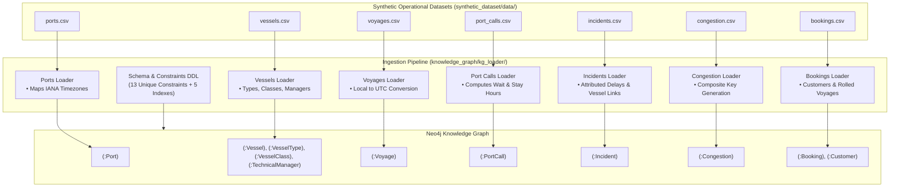

# Maritime Knowledge Graph - Ingestion Pipeline & Loader

A high-performance, idempotent data ingestion pipeline that transforms structured maritime operational tabular data into a **Neo4j Knowledge Graph**. The system standardizes all timestamps to UTC using port-specific IANA timezones, enforces strict domain ontology constraints, and computes operational metrics (anchorage waiting durations, port turnaround stays, attributed delays, and rolled container tracking).

---

## 1. Architecture Overview



---

## 2. Ingestion Order & Schema Features

1. **Schema Initialization (`knowledge_graph/kg_loader/schema.py`)**:
   - Applies 13 `CREATE CONSTRAINT ... REQUIRE ... IS UNIQUE` statements across all node identifiers (`vessel_id`, `imo`, `port_code`, `voyage_id`, `call_id`, `incident_id`, `congestion_id`, `booking_id`, `customer_id`, etc.).
   - Applies performance indexes on high-frequency query timestamps (`revised_eta_utc`, `reported_utc`, `date_utc`, `promised_delivery_date_utc`).

2. **Ports (`ports.csv`)**:
   - Creates `(:Port {port_code, name, country, timezone})`.
   - Builds a port timezone dictionary (`port_code -> timezone`) for downstream UTC normalization.

3. **Fleet & Classification (`vessels.csv`)**:
   - Creates `(:Vessel)`, `(:VesselType)`, `(:VesselClass)`, and `(:TechnicalManager)`.
   - Creates relationships `[:OF_TYPE]`, `[:OF_CLASS]`, and `[:MANAGED_BY]`.

4. **Voyages (`voyages.csv`)**:
   - Converts origin `departure_local` to `departure_utc` using origin port IANA timezone.
   - Converts destination `original_eta_local`, `revised_eta_local`, `berth_window_start_local`, and `berth_window_end_local` to UTC using destination port timezone.
   - Establishes relationships `(:Vessel)-[:OPERATES_VOYAGE]->(:Voyage)`, `(:Voyage)-[:DEPARTS_FROM]->(:Port)`, and `(:Voyage)-[:ARRIVES_AT]->(:Port)`.

5. **Port Calls (`port_calls.csv`)**:
   - Ingests milestone timestamps (`anchorage_arrival_utc`, `berth_scheduled_utc`, `berthing_utc`, `departure_utc`).
   - Computes `anchorage_wait_hours` (`berthing - arrival`) and `port_stay_hours` (`departure - berthing`).
   - Links `(:Voyage)-[:HAS_PORT_CALL]->(:PortCall)`, `(:PortCall)-[:AT_PORT]->(:Port)`, and `(:PortCall)-[:CALL_BY]->(:Vessel)`.

6. **Incidents (`incidents.csv`)**:
   - Ingests disruption records with `reported_utc` and `attributed_delay_hours`.
   - Links `(:Voyage)-[:EXPERIENCED_INCIDENT]->(:Incident)` and derived shortcut `(:Incident)-[:AFFECTS_VESSEL]->(:Vessel)`.

7. **Congestion (`congestion.csv`)**:
   - Generates composite primary key `CONG_<port>_<date>` (e.g. `CONG_SGSIN_2026-09-17`).
   - Links `(:Port)-[:HAS_CONGESTION]->(:Congestion)`.

8. **Bookings & Customers (`bookings.csv`)**:
   - Creates `(:Customer)` and `(:Booking)`.
   - Sets `is_rolled` boolean and links `(:Booking)-[:BOOKED_ON]->(:Voyage)`.
   - If cargo is rolled to an explicit voyage (e.g. `Rolled to VG-1107`), creates `(:Booking)-[:ROLLED_TO]->(:Voyage)`.

---

## 3. Directory Layout

```
maritime-assistant/
├── knowledge_graph/
│   ├── config.py                       # Configuration & path resolvers
│   ├── database.py                     # Neo4j client & session execution
│   └── kg_loader/                      # Ingestion pipeline & normalizers
│       ├── main.py                     # CLI ingestion entrypoint
│       ├── pipeline.py                 # Pipeline orchestrator
│       ├── schema.py                   # Constraints & index DDL
│       ├── normalizers.py              # UTC timezone & duration converters
│       └── loaders/
│           ├── base.py                 # CSV reader & batched UNWIND executor
│           ├── ports_loader.py         # Ports & IANA timezone mapping
│           ├── vessels_loader.py       # Vessels, types, classes, managers
│           ├── voyages_loader.py       # Local-to-UTC normalized voyages
│           ├── port_calls_loader.py    # Milestones & computed wait/stay hours
│           ├── incidents_loader.py     # Disruption records & vessel links
│           ├── congestion_loader.py    # Composite port congestion logs
│           └── bookings_loader.py      # Customer bookings & rolled links
│
├── synthetic_dataset/                  # Operational test data (CSVs)
│   └── data/
│
├── tests/
│   └── test_ingestion.py               # Unit tests for normalizers & loaders
│
├── pyproject.toml                      # Project metadata & dependencies
└── .env.example                        # Environment template
```

---

## 4. Configuration & Setup

### Environment Variables
Create `.env` from `.env.example`:

```ini
NEO4J_URI=bolt://localhost:7687
NEO4J_USER=neo4j
NEO4J_PASSWORD=password
NEO4J_DATABASE=neo4j
```

### Installation
Dependencies are managed via `uv`:

```powershell
uv sync
```

---

## 5. Usage

### Dry-Run Validation (No Database Required)
Validates all CSV records, runs timezone conversions, and computes duration metrics without executing database queries:

```powershell
uv run python -m knowledge_graph.kg_loader.main --dry-run
```

### Live Ingestion to Neo4j
Loads all CSVs into your Neo4j instance:

```powershell
uv run python -m knowledge_graph.kg_loader.main
```

### Clear Database & Re-Ingest
Wipes existing graph elements and performs fresh ingestion:

```powershell
uv run python -m knowledge_graph.kg_loader.main --clear
```

### CLI Options
```
--data-dir PATH     Path to synthetic dataset CSV directory (default: synthetic_dataset/data)
--uri URI           Neo4j connection URI (override .env NEO4J_URI)
--user USER         Neo4j username (override .env NEO4J_USER)
--password PWD      Neo4j password
--database DB       Neo4j database name (default: neo4j)
--batch-size N      Batch size for UNWIND transactions (default: 500)
--clear             Clear existing graph before ingestion
--dry-run           Parse and validate CSVs without connecting to Neo4j
-v, --verbose       Enable verbose debug logging
```

---

## 6. Running Tests

Run the test suite verifying timezone conversions, duration computations, normalizers, and dry-run ingestion:

```powershell
uv run python -m unittest tests/test_ingestion.py
```
