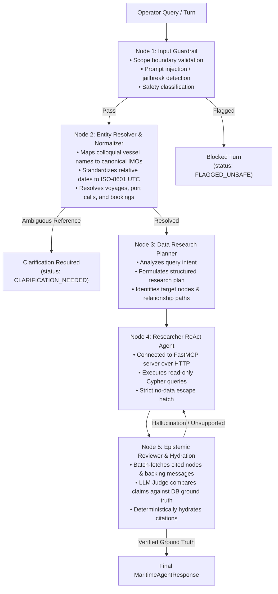

# Maritime Operations AI Agent

A production-grade, 5-layer autonomous maritime operations assistant built with **LangGraph**, **FastMCP**, and **Neo4j Knowledge Graph**. 

The agent assists fleet dispatchers, port captains, and cargo superintendents in tracking vessels, analyzing voyage delays, tracing container bookings, investigating disruption root-causes, and cross-referencing operational messages with strict epistemic grounding.

---

## 1. Five-Layer LangGraph Architecture

The AI agent executes as a cyclic StateGraph where incoming turns pass through 5 specialized nodes:



### The 5 Nodes

1. **`node_1_guardrail` ([`guardrail_node.py`](file:///ai_agent/src/agent/nodes/guardrail_node.py))**:
   - Assesses query scope (commercial maritime fleet management, delays, incidents, bookings, port congestion).
   - Defends against adversarial prompt injections and jailbreak attempts.
2. **`node_2_resolver` ([`entity_resolver_node.py`](file:///ai_agent/src/agent/nodes/entity_resolver_node.py))**:
   - Standardizes temporal references (e.g., "last Tuesday", "yesterday noon") against snapshot timestamps into ISO 8601 UTC.
   - Detects ambiguous entity references (e.g., "the Atlas ship") and returns a clean clarification question without guessing.
3. **`node_3_planner` ([`planner_node.py`](file:///ai_agent/src/agent/nodes/planner_node.py))**:
   - Generates a structured research plan (`summary_of_intent`, `target_entities`, `relevant_kg_nodes`, `relevant_relationships`, `data_points_to_check`).
   - Renders the plan directly into the researcher agent's system prompt.
4. **`node_4_researcher` ([`researcher_node.py`](file:///ai_agent/src/agent/nodes/researcher_node.py))**:
   - Connects to the Maritime FastMCP Server over Streamable HTTP (`MARITIME_MCP_SERVER_URL`).
   - Exclusively uses the read-only query tool (`execute_read_query`).
   - Produces compact structured output (`ResearcherResponse`) containing claims and citations `{node, id}`, or signals `data_available=false` with `no_data_reason`.
5. **`node_5_validator` ([`reviewer_node.py`](file:///ai_agent/src/agent/nodes/reviewer_node.py))**:
   - Batch-fetches full attributes and connected backing messages across all 12 KG node types using a single Cypher query (`UNWIND $citations AS citation`).
   - Runs an LLM Judge to ensure every claim is grounded in the retrieved database records.
   - On review pass, deterministically hydrates verified node properties and message bodies into the final `MaritimeAgentResponse`.
   - On review failure, routes back to `node_4_researcher` with targeted critique (up to 2 retries).

---

## 2. Epistemic Grounding Model

Every response is structured to maintain strict epistemic rigor:

| Epistemic Tier | Description | Source |
| :--- | :--- | :--- |
| **`confirmed_facts`** | Direct facts verified by database attributes or high-trust logs. | Knowledge Graph node properties & Tier 1/2 messages. |
| **`unverified_reports`** | Preliminary or pending reports that have not yet been formally corroborated. | Tier 3/4 messages, agent emails, or unconfirmed radio notes. |
| **`system_inferences`** | Explicit deductions, calculations, or projections with clear rationales. | Derived logic (e.g. ETA adjustments = original ETA + delay hours). |
| **`false_premises`** | Misconceptions in user queries identified and refuted. | Verified negative graph facts. |
| **`no_data_reason`** | Explicit reason for abstention when data is absent. | `NO_MATCHING_DATA`, `INSUFFICIENT_DATA`, `ENTITY_NOT_FOUND`, etc. |

---

## 3. Swagger & OpenAPI Documentation

Interactive and machine-readable API documentation is available out-of-the-box:

- **Swagger UI**: [http://localhost:8000/docs](http://localhost:8000/docs)
- **ReDoc**: [http://localhost:8000/redoc](http://localhost:8000/redoc)
- **Static OpenAPI JSON**: [`ai_agent/docs/openapi.json`](file:///ai_agent/docs/openapi.json)
- **Static Swagger JSON**: [`ai_agent/docs/swagger.json`](file:///ai_agent/docs/swagger.json)
- **Swagger Markdown Reference**: [`ai_agent/docs/SWAGGER.md`](file:///ai_agent/docs/SWAGGER.md)

---

## 4. REST API Endpoints

### Authentication
- `POST /api/auth/register` — Registers new operator; returns JWT bearer token.
- `POST /api/auth/login` — Authenticates operator credentials; returns JWT bearer token.
- `GET /api/auth/me` — Fetches current operator profile (`Authorization: Bearer <token>`).

### Multi-Turn Conversational Operations
- `POST /api/chat` — Submits query to the 5-layer LangGraph pipeline. Returns typed `MaritimeAgentResponse`.
- `GET /api/chat/threads` — Lists all conversation sessions for current operator.
- `GET /api/chat/threads/{thread_id}/history` — Retrieves chronological message turns and structured epistemic payloads.
- `DELETE /api/chat/threads/{thread_id}` — Deletes conversation thread and session data.

### System Diagnostics
- `GET /api/system/health` — Probes Neo4j, FastMCP bridge, and LLM provider connectivity.
- `GET /api/system/schema` — Inspects registered Knowledge Graph labels and relationship types.

---

## 5. Quickstart & Server Launch

### 1. Environment Configuration
Ensure your `.env` is configured:

```ini
# LLM Provider (openrouter, groq, gemini)
LLM_PROVIDER=openrouter
OPENROUTER_API_KEY=sk-or-v1-...
OPENROUTER_MODEL=deepseek/deepseek-v4-flash-vision-exp

# Maritime FastMCP Server URL
MARITIME_MCP_SERVER_URL=http://localhost:8000/mcp

# Neo4j Database
NEO4J_URI=bolt://localhost:7687
NEO4J_USER=neo4j
NEO4J_PASSWORD=your_password
```

### 2. Launch All Services (One Command)
Run the cross-platform unified launcher to start the FastMCP Server (8000), AI Agent API (8080), and Frontend Vite UI (5173) simultaneously:

```powershell
# Using Python
python start.py

# Or using PowerShell launcher
.\run.ps1

# Or using Docker Compose
docker compose up --build
```

You can also run services independently:

```powershell
# Run API server only (serves both API and bundled Web UI on port 8080)
uv run python -m ai_agent.src.api.main

# Run FastMCP server only (port 8000)
uv run python -m knowledge_graph.maritime_kg_mcp.main --transport http --port 8000

# Run Frontend Vite dev server (port 5173)
npm --prefix frontend run dev
```

---

## 6. Directory Layout

```
ai_agent/
├── docs/
│   ├── SWAGGER.md                  # Comprehensive Markdown Swagger API guide
│   ├── openapi.json                # Complete OpenAPI 3.1.0 specification
│   └── swagger.json                # Standard Swagger JSON specification
│
├── src/
│   ├── agent/                      # LangGraph 5-layer pipeline
│   │   ├── client/                 # LLM provider integration
│   │   │   └── llm_client.py       # Multi-provider LLM factory (OpenRouter, Groq, Gemini)
│   │   ├── nodes/                  # The 5 Pipeline Nodes
│   │   │   ├── guardrail_node.py   # Node 1: Input Guardrail
│   │   │   ├── entity_resolver_node.py # Node 2: Entity Resolution & Clarification
│   │   │   ├── planner_node.py     # Node 3: Data Research Planner
│   │   │   ├── researcher_node.py  # Node 4: FastMCP ReAct Researcher
│   │   │   └── reviewer_node.py    # Node 5: Epistemic Reviewer & Hydration
│   │   ├── prompts/                # Externalized YAML prompt templates & loaders
│   │   ├── memory/                 # Thread checkpointing & session state
│   │   ├── graph.py                # LangGraph StateGraph pipeline wiring
│   │   └── state.py                # Typed AgentState definition
│   │
│   ├── api/                        # FastAPI Web API
│   │   ├── dependencies.py         # JWT bearer authentication & security
│   │   ├── main.py                 # FastAPI application & OpenAPI metadata
│   │   └── routes/                 # Modular endpoints
│   │       ├── auth.py             # Operator registration & login
│   │       ├── chat.py             # Multi-turn chat & thread management
│   │       └── system.py           # Health checks & schema inspector
│   │
│   ├── repo/
│   │   └── database.py             # SQLite operator store, thread & message persistence
│   │
│   ├── schemas/                    # Pydantic epistemic models & DTOs
│   │   ├── epistemic.py            # MaritimeAgentResponse, Citations, Epistemic Tiers
│   │   ├── researcher_agent_dto.py # ResearcherResponse & NoDataReason
│   │   ├── grounding_review_dto.py # LLM Judge review schema
│   │   ├── entity_resolver_dto.py  # Entity resolution & clarification schemas
│   │   └── input_guardrail_dto.py  # Guardrail validation schemas
│   │
│   └── utilities/
│       └── logger.py               # Structured JSON logging
│
├── storage/                        # SQLite message history database
└── README.md
```
