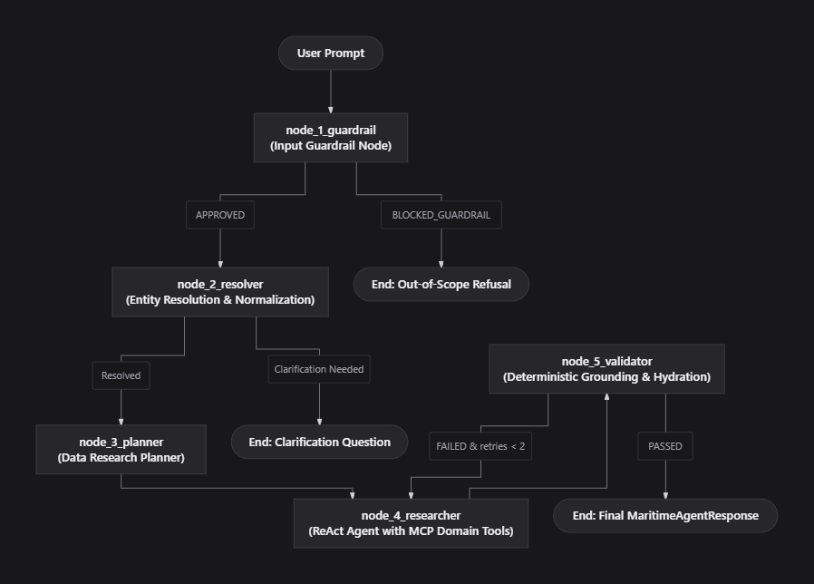
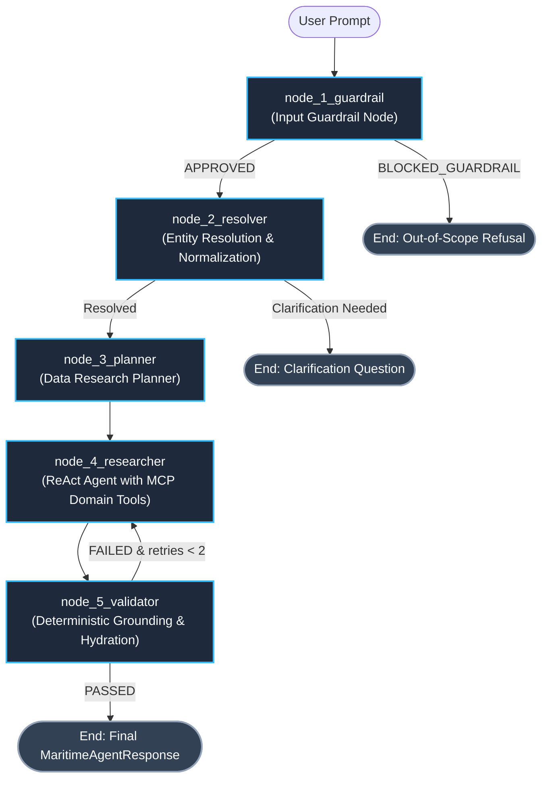
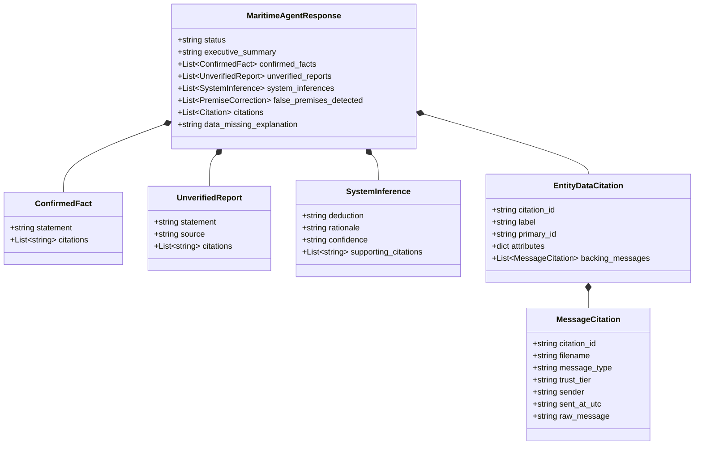

# Maritime Operations AI Agent — System Architecture & Design

**Document Version:** 2.0.0  
**Status:** Implemented & Production-Ready  
**Technology Stack:** LangGraph, FastMCP (Streamable HTTP), Neo4j Knowledge Graph, Pydantic v2, SQLite  
**Location:** `ai_agent/docs/DESIGN.md`  

---

## 1. Overview & System Mission

The **Maritime Operations AI Agent** is an autonomous, stateful intelligence system engineered for commercial shipping operators, fleet dispatchers, port captains, and logistics superintendents. It reasons over both structured tabular graph relationships and unstructured multi-tier communications to deliver grounded operational answers.

### Core Capabilities
- **Fleet & Vessel Tracking:** Inspects ship profiles, nominal capacities, technical managers, and sister-ship design classes.
- **Voyage & Transit Analysis:** Tracks schedules, departures, arrivals, recorded delay hours, and berth-window missed assessments.
- **Port Bottleneck & Congestion Intelligence:** Monitors daily seaport anchorage queues, average wait times, and terminal turnaround durations.
- **Disruption & Incident Root-Cause Investigation:** Traces machinery failures, weather detours, bunkering delays, and multi-scope defect recurrences across vessels, classes, and managers.
- **Cargo Exposure & Rolled Container Tracking:** Evaluates customer shipments, contract delivery commitments, and bumped cargo allocations.
- **Epistemic Intelligence & Corroboration:** Cross-references formal noon reports, official agent notices, technical bulletins, and crew communications with strict epistemic segregation.

---

## 2. Graph Architecture & Control Flow

The agent is implemented as a 5-node cyclic **LangGraph `StateGraph`** with persistent checkpointing. Incoming queries flow sequentially through input guardrails, entity resolution, data research planning, ReAct domain research over FastMCP, and deterministic graph validation/hydration.

### Architecture Graph Diagram



### Control Flow Overview



### Graph Execution Lifecycle

1. **`node_1_guardrail` (Input Guardrail):** Screens the user prompt for domain relevance, prompt injection attacks, and toxicity.
   - If blocked $\rightarrow$ Terminates immediately with an out-of-scope refusal.
   - If approved $\rightarrow$ Transitions to `node_2_resolver`.
2. **`node_2_resolver` (Entity Resolution & Temporal Normalization):** Canonicalizes vessel names to IDs, ports to UN/LOCODEs, and relative dates to ISO-8601 UTC.
   - If ambiguous $\rightarrow$ Terminates the turn with a concise clarification question while maintaining an isolated clarification chat history.
   - If resolved $\rightarrow$ Clears temporary clarification history and transitions to `node_3_planner`.
3. **`node_3_planner` (Data Research Planner):** Generates a structured research plan specifying targets, Knowledge Graph labels, relationship paths, and data points to check. Injects instructions into the researcher agent's prompt.
4. **`node_4_researcher` (Researcher ReAct Agent):** Connects to the FastMCP server over HTTP, invokes specialized domain tools, and constructs a structured `ResearcherResponse` containing claims and `{node, id}` citations.
5. **`node_5_validator` (Deterministic Grounding & Hydration):** Batch-retrieves full graph attributes and backing messages from Neo4j in a single query, deterministically verifies citation existence, hydrates verified citations, and checks validity.
   - If validation fails (`validation_retries < 2`) $\rightarrow$ Routes back to `node_4_researcher` with targeted feedback (self-correction loop).
   - If passed or retries exhausted $\rightarrow$ Emits the final `MaritimeAgentResponse` and terminates at `END`.

---

## 3. Node Specifications & Implementation

### Node 1: Input Guardrail (`node_1_guardrail`)
- **Module:** [`ai_agent.src.agent.nodes.guardrail_node`](file:///ai_agent/src/agent/nodes/guardrail_node.py)
- **Function:** `input_guardrail_node(state: AgentState) -> InputGuardrailNodeResponse`
- **Output Schema:** `InputGuardrailNodeResponse(user_query, validation_status, final_response)`

#### Core Functionality
- **Domain Scope Validation:** Validates that the query pertains to commercial shipping, fleet management, transits, seaports, incidents, or container logistics. General greetings ("hello", "help") are approved with conversational intent.
- **Injection & Security Screening:** Detects prompt override commands, secret key exfiltration attempts, and unauthorized mutation instructions.
- **Toxicity Detection:** Identifies abusive, profane, or inappropriate messages.
- **Routing Decision:**
  - `validation_status = "BLOCKED_GUARDRAIL"` $\rightarrow$ Immediate termination with structured refusal (`OUT_OF_SCOPE_REFUSAL`).
  - `validation_status = "APPROVED"` $\rightarrow$ Continues to `node_2_resolver`.

---

### Node 2: Entity Resolver & Temporal Normalizer (`node_2_resolver`)
- **Module:** [`ai_agent.src.agent.nodes.entity_resolver_node`](file:///ai_agent/src/agent/nodes/entity_resolver_node.py)
- **Function:** `entity_resolution_node(state: AgentState) -> EntityResolutionNodeResponse`
- **Output Schema:** `EntityResolutionNodeResponse(normalized_query, resolved_entities, needs_clarification, ...)`

#### Core Functionality
- **Canonical Entity Mapping:** Standardizes informal or colloquial mentions:
  - *Vessels:* `"Ocean Star"` $\rightarrow$ `{"vessel_id": "V001", "name": "MV Ocean Star", "imo": 9876543}`.
  - *Ports:* `"Rotterdam"` $\rightarrow$ `{"port_code": "NLRTM", "name": "Rotterdam"}`.
  - *Voyages:* Canonical voyage format (e.g., `"VG-1042"`).
- **Temporal Normalization:** All relative dates ("yesterday", "last week", "upcoming", "now") are resolved relative to the fixed operational snapshot timestamp:
  - **Reference Anchor:** `2026-10-26T12:00:00Z`
  - **Date Format:** ISO-8601 UTC string format: `"%Y-%m-%dT%H:%M:%SZ"`.
- **Isolated Clarification Dialogue Channel:**
  - If entity ambiguity is detected (e.g., "the Ocean vessel" when both *Ocean Star* and *Ocean Pearl* exist), generates a single concise question without multiple-choice options.
  - Uses an isolated channel (`entity_resolver_messages`) to track clarification turns across user requests.
  - Upon successful resolution, the temporary resolver channel is completely cleared, ensuring clarification exchanges never pollute main conversational memory (`clean_messages`).

---

### Node 3: Data Research Planner (`node_3_planner`)
- **Module:** [`ai_agent.src.agent.nodes.planner_node`](file:///ai_agent/src/agent/nodes/planner_node.py)
- **Function:** `planner_node(state: AgentState) -> Dict[str, Any]`
- **Output:** `{"research_plan": str}`

#### Core Functionality
- Formulates a structured data research plan by evaluating user intent and resolved entities against the Maritime Knowledge Graph schema.
- Generates clear instructions covering:
  1. **Research Plan Objective:** Target operational questions to resolve.
  2. **Target Entities:** Canonical IDs and names.
  3. **Relevant KG Node Labels:** (`Vessel`, `Voyage`, `PortCall`, `Incident`, `Congestion`, `Booking`, `Message`).
  4. **Relationship Paths:** (`OPERATES_VOYAGE`, `HAS_PORT_CALL`, `EXPERIENCED_INCIDENT`, `BOOKED_ON`, `ROLLED_TO`).
  5. **Data Points to Verify:** Specific operational metrics (berth window boundaries, actual arrival times, delay hours, backing reports).
- The resulting plan is formatted as structured text and injected directly into the researcher agent's context prompt.

---

### Node 4: Researcher ReAct Agent (`node_4_researcher`)
- **Module:** [`ai_agent.src.agent.nodes.researcher_node`](file:///ai_agent/src/agent/nodes/researcher_node.py)
- **Function:** `researcher_node(state: AgentState) -> Dict[str, Any]`
- **Output:** `{"draft_response": ResearcherResponse, "cypher_queries_executed": List[str]}`

#### Architecture & MCP Tool Access
The researcher agent runs as a ReAct loop connected to the FastMCP server over Streamable HTTP (`MARITIME_MCP_SERVER_URL`) via LangChain's `MCPAdapter`.

To ensure reliability, security, and consistent graph-text synthesis, the researcher agent is **strictly constrained to specialized domain context tools**:

| Tool Name | Domain Capability |
| :--- | :--- |
| **`get_vessel_context`** | Retrieves vessel profile, sister ships, active/recent voyages, incidents, and class engineering bulletins. |
| **`get_voyage_context`** | Comprehensive single-voyage dossier: vessel info, origin/destination ports, port calls, destination congestion around ETA, incidents with evidence tier, bookings summary, berth-window verdict, and delay reconciliation. |
| **`scan_voyages`** | Multi-voyage scanning across ports or fleet, ranking transits by berth-window missed risk, delay hours, or arrival window. |
| **`get_port_context`** | Seaport operations summary: congestion time-series, average anchorage wait hours, queued vessels, port agents, and inbound voyages. |
| **`search_incident_history`** | Multi-scope defect recurrence search across four scopes: target vessel, vessel class (sister ships), technical manager, and fleet. |
| **`get_cargo_exposure`** | Commercial shipment exposure for a voyage: cargo on board, rolled shipments (`is_rolled=true`), cancelled bookings, and promised delivery date risk. |
| **`track_booking`** | Pinpoint container tracking by booking ID, customer name, or assigned voyage. |
| **`search_messages`** | Full-text and metadata search across operational messages, noon reports, agent emails, and engineering bulletins across trust tiers (T1–T4). |
| **`get_knowledge_graph_schema`** | Schema metadata inspection: labels, relationship types, and database constraints. |

#### Reliability & Fallback Mechanics
- **SummarizationMiddleware:** Triggers when token count reaches 6,000 tokens, preserving the 20 most recent messages to prevent context exhaustion.
- **Exponential Backoff with Full Random Jitter:** Automatically retries up to 3 times on transient connection errors with jittered delays (`delay = uniform(0.5, 1.5) * min(10.0, 1.5 * 2^attempt)`).
- **Graceful Abstention:** If no data exists or retries are exhausted, emits a structured `ResearcherResponse(data_available=False, no_data_reason=...)` with clear explanation rather than raising an unhandled exception.

---

### Node 5: Grounding Validator & Hydration (`node_5_validator`)
- **Module:** [`ai_agent.src.agent.nodes.reviewer_node`](file:///ai_agent/src/agent/nodes/reviewer_node.py)
- **Function:** `validator_and_hydration_node(state: AgentState) -> Dict[str, Any]`
- **Output:** `{"final_response": MaritimeAgentResponse, "validation_status": "PASSED" | "FAILED", "db_ground_truth": dict}`

#### Deterministic Validation & Hydration
Node 5 enforces database ground-truth fidelity without secondary LLM grading latency:

1. **Citation Extraction:** Scans `confirmed_facts`, `unverified_reports`, and `system_inferences` in the researcher's output and extracts all `{node, id}` citation tuples.
2. **Single-Batch Cypher Retrieval:** Executes `FETCH_ALL_CITED_NODES_CYPHER` (`UNWIND $citations AS citation MATCH (n)...`) in a single round-trip to retrieve full properties and connected backing messages for every cited entity.
3. **Deterministic Existence Verification:** Verifies that all cited node IDs exist in the Neo4j database. Unverified citations are flagged and logged.
4. **Deterministic Graph Hydration:**
   - Constructs rich `EntityDataCitation` objects with complete node properties.
   - Extracts and attaches linked `MessageCitation` objects (including sender, timestamp, trust tier, and verbatim text).
   - Generates unique citation IDs (`[CIT-001]`, `[CIT-002]`).
5. **Self-Correction Retry Gate:** If validation fails and `validation_retries < 2`, routes back to `node_4_researcher` with targeted feedback. Otherwise, compiles the final `MaritimeAgentResponse`.

---

## 4. State Management (`AgentState`)

The complete state schema is defined in [`ai_agent/src/agent/state.py`](file:///ai_agent/src/agent/state.py):

```python
class AgentState(TypedDict):
    # Full message history (with LangGraph add_messages reducer)
    messages: Annotated[List[BaseMessage], add_messages]

    # Filtered conversational memory (Human & AI messages only)
    clean_messages: List[BaseMessage]

    # Input Processing
    user_query: str
    normalized_query: str
    resolved_entities: Dict[str, Any]

    # Isolated Entity Resolver Clarification Chat
    entity_resolver_messages: List[BaseMessage]
    entity_resolution_pending: bool

    # Clarification Feedback
    needs_clarification: bool
    clarification_prompt: Optional[str]

    # Data Research Planner
    research_plan: Optional[str]

    # Agent Generation
    draft_response: Optional[Union[ResearcherResponse, MaritimeAgentResponse]]
    cited_entity_keys: List[str]
    cited_message_files: List[str]
    cypher_queries_executed: List[str]

    # Grounding Validation & Review
    db_ground_truth: Dict[str, Any]
    validation_status: str           # "APPROVED", "FAILED", "PASSED", "BLOCKED_GUARDRAIL"
    validation_feedback: Optional[str]
    validation_retries: int

    # Final Hydrated Output
    final_response: Optional[MaritimeAgentResponse]
```

---

## 5. Epistemic Segregation Architecture

Every response is partitioned into strict epistemic categories to ensure operators never confuse ground-truth physical records with informal reports or algorithmic deductions:



### Epistemic Categories

| Category | Definition | Source Criteria |
| :--- | :--- | :--- |
| **`confirmed_facts`** | Direct facts verified by physical telemetry or confirmed database records. | Tabular nodes with verified status or Tier 1 / Tier 2 messages. |
| **`unverified_reports`** | Preliminary, reported, or unconfirmed operational claims. | Tabular records with status `'Reported'` or `'Under review'`; Tier 3 / Tier 4 messages (crew WhatsApp, shipper claims). |
| **`system_inferences`** | Deductions, delay reconciliations, and forward schedule calculations. | Derived calculations (e.g. `revised_eta_utc > berth_window_end_utc` $\rightarrow$ vessel will miss berth window). |
| **`false_premises`** | Refutation of false assumptions made in the user prompt. | Verified negative graph facts contradicting user statements. |
| **`citations`** | Hydrated evidence records linking claims to graph entities and files. | `EntityDataCitation` (with properties & backing messages) and `MessageCitation`. |

### Evidence Hierarchy & Trust Tiers

- **Tier 1 (T1) — Master's Noon Reports:** Primary authoritative shipboard telemetry (speed, RPM, bunker consumption, GPS coordinates).
- **Tier 2 (T2) — Official Port Agents & Technical Management Bulletins:** Formal shore-side operational communications and class engineering directives.
- **Tier 3 (T3) — Crew Informal Messages & Relays:** Bridge chatter, WhatsApp communications, and informal maintenance reports (treated as unverified reports unless corroborated).
- **Tier 4 (T4) — Commercial Customer Forwards:** External shipper claims and delivery inquiries requiring verification against graph bookings.

---

## 6. Persistence & Session Checkpointing

- **Checkpointer:** `AsyncSqliteCheckpointer` located in [`ai_agent/src/agent/memory/checkpointer.py`](file:///ai_agent/src/agent/memory/checkpointer.py).
- **Storage Path:** `storage/checkpoints.db`.
- **Session Isolation:** Executions are partitioned by `thread_id` configured via LangGraph runnable config:
  ```python
  config = {"configurable": {"thread_id": thread_id}}
  ```
- **Serialization Sanitization:** Custom recursive sanitization (`_sanitize_for_msgpack`) converts Neo4j temporal objects (`DateTime`, `Date`) into native strings and primitives prior to messagepack serialization.

---

## 7. Failure Handling & Recovery Behaviors

| Scenario | Detection Point | Handling & Recovery Behavior |
| :--- | :--- | :--- |
| **Out-of-Scope Prompt** | `node_1_guardrail` | Flags `validation_status = "BLOCKED_GUARDRAIL"`. Returns `OUT_OF_SCOPE_REFUSAL` immediately without invoking downstream nodes. |
| **Ambiguous Query** | `node_2_resolver` | Sets `needs_clarification = True`. Halts turn, returning a single concise question. Maintains isolated `entity_resolver_messages` to resume seamlessly on follow-up answer. |
| **Transient Tool Timeout** | `node_4_researcher` | Exponential backoff with randomized jitter (up to 3 retries). If retries exhaust, gracefully falls back to `ResearcherResponse(data_available=False, no_data_reason=DATA_SOURCE_ERROR)`. |
| **Context Length Growth** | `node_4_researcher` | `SummarizationMiddleware` automatically compacts history above 6,000 tokens down to 20 messages. |
| **Unverified Citations** | `node_5_validator` | Verifies existence in Neo4j. If critical citations cannot be located and `retries < 2`, triggers self-correction loop back to `node_4_researcher` with targeted feedback. |
| **No Matching Data in KG** | `node_4_researcher` | Explicitly signals `data_available = False` with typed reason (`NO_MATCHING_DATA`, `ENTITY_NOT_FOUND`). Node 5 generates clean `DATA_UNAVAILABLE` response with zero fabricated facts. |

---

## 8. Directory & File Reference Map

```
ai_agent/
├── docs/
│   ├── assets/
│   │   └── agent_graph_architecture.png       # Graph architecture diagram
│   ├── DESIGN.md                              # Authoritative design document
│   ├── SWAGGER.md                             # REST API endpoint documentation
│   ├── openapi.json                           # OpenAPI specification
│   └── swagger.json                           # Swagger specification
├── src/
│   ├── agent/
│   │   ├── client/
│   │   │   └── llm_client.py                  # LLM factory & providers
│   │   ├── memory/
│   │   │   └── checkpointer.py                # Async SQLite state checkpointer
│   │   ├── nodes/
│   │   │   ├── guardrail_node.py              # Node 1: Input Guardrail
│   │   │   ├── entity_resolver_node.py        # Node 2: Entity Resolver
│   │   │   ├── planner_node.py                # Node 3: Research Planner
│   │   │   ├── researcher_node.py             # Node 4: Researcher ReAct Agent
│   │   │   └── reviewer_node.py               # Node 5: Validator & Hydration
│   │   ├── prompts/
│   │   │   └── prompt_loader.py               # YAML prompt template loader
│   │   ├── graph.py                           # StateGraph assembly & routing
│   │   └── state.py                           # AgentState channel definitions
│   └── schemas/
│       ├── epistemic.py                       # MaritimeAgentResponse & Citations
│       ├── researcher_agent_dto.py            # ResearcherResponse DTO
│       ├── planner_dto.py                     # DataResearchPlan DTO
│       ├── entity_resolver_dto.py             # EntityResolutionResponse DTO
│       └── input_guardrail_dto.py             # InputGuardrailResponse DTO
```
