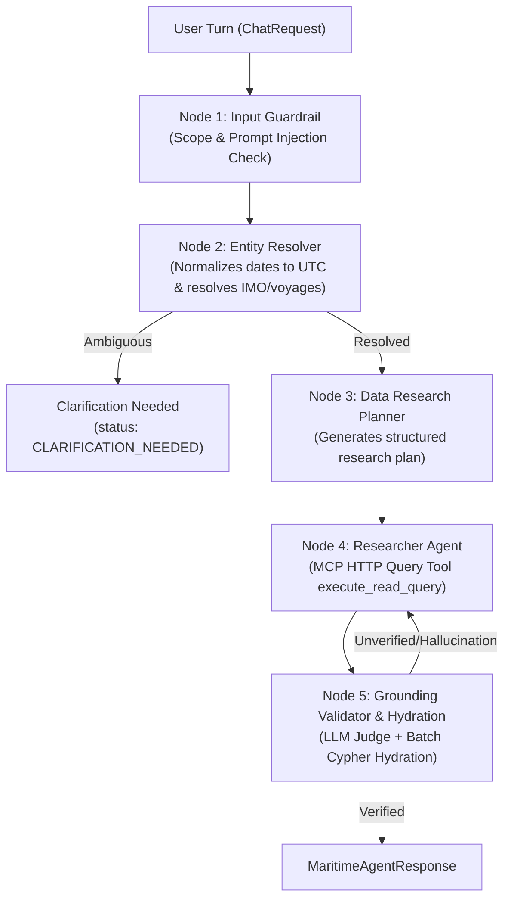

# Maritime Operations AI Agent — Swagger API Reference

An intelligent, multi-turn commercial maritime operations assistant built with **LangGraph**, **FastMCP**, and **Neo4j Knowledge Graph**. The API enforces strict epistemic grounding, zero-hallucination verification via an LLM judge, and deterministic citation hydration.

---

## 1. Interactive Documentation & Endpoints

When running the API server (`http://localhost:8000`), the interactive documentation interfaces are automatically available:

- **Swagger UI (Interactive API Explorer)**: [http://localhost:8000/docs](http://localhost:8000/docs)
  - Features interactive request testing with the `Authorize` button for JWT bearer tokens.
- **ReDoc (Technical Documentation)**: [http://localhost:8000/redoc](http://localhost:8000/redoc)
- **OpenAPI 3.1.0 Spec (JSON)**: [http://localhost:8000/openapi.json](http://localhost:8000/openapi.json) (also persisted at [`ai_agent/docs/openapi.json`](openapi.json))
- **Swagger JSON Spec**: [`ai_agent/docs/swagger.json`](swagger.json)

---

## 2. Authentication Flow

Protected endpoints require a standard HTTP Authorization header with a signed JWT bearer token:

```http
Authorization: Bearer <your_jwt_token>
```

Tokens are valid for 24 hours and encode operator identity (`sub`, `username`, `role`).

---

## 3. API Endpoints Overview

| Method | Endpoint | Auth | Tag | Summary |
| :--- | :--- | :---: | :---: | :--- |
| `GET` | `/` | No | Root | Service info and link to Swagger `/docs` |
| `POST` | `/api/auth/register` | No | Auth | Register a new fleet dispatcher/operator |
| `POST` | `/api/auth/login` | No | Auth | Authenticate operator and receive JWT token |
| `GET` | `/api/auth/me` | **Bearer** | Auth | Get current operator profile and assigned role |
| `POST` | `/api/chat` | **Bearer** | Chat | Submit user query through 5-layer LangGraph pipeline |
| `GET` | `/api/chat/threads` | **Bearer** | Chat | List all conversational sessions for current user |
| `GET` | `/api/chat/threads/{thread_id}/history` | **Bearer** | Chat | Retrieve full historical turns and structured responses |
| `DELETE`| `/api/chat/threads/{thread_id}` | **Bearer** | Chat | Delete conversation thread and session data |
| `GET` | `/api/system/health` | No | System | Check Neo4j, FastMCP bridge, and LLM provider status |
| `GET` | `/api/system/schema` | No | System | Inspect Knowledge Graph node labels & relationship types |

---

## 4. Endpoint Details & Schemas

### 4.1 Authentication

#### `POST /api/auth/register`
Creates a new operator account and returns an initial JWT bearer token.

**Request Body:**
```json
{
  "username": "dispatcher_smith",
  "email": "smith@maritime-ops.com",
  "password": "SecurePassword2026!",
  "full_name": "Captain John Smith",
  "role": "fleet_dispatcher"
}
```

**Response (200 OK):**
```json
{
  "access_token": "eyJhbGciOiJIUzI1NiIsInR5cCI6...",
  "token_type": "bearer",
  "user": {
    "user_id": "usr_94b51a0b3c",
    "username": "dispatcher_smith",
    "email": "smith@maritime-ops.com",
    "full_name": "Captain John Smith",
    "role": "fleet_dispatcher",
    "created_at": "2026-11-03 06:10:00"
  }
}
```

---

#### `POST /api/auth/login`
Authenticates existing operator credentials.

**Request Body:**
```json
{
  "username_or_email": "dispatcher_smith",
  "password": "SecurePassword2026!"
}
```

**Response (200 OK):**
```json
{
  "access_token": "eyJhbGciOiJIUzI1NiIsInR5cCI6...",
  "token_type": "bearer",
  "user": {
    "user_id": "usr_94b51a0b3c",
    "username": "dispatcher_smith",
    "email": "smith@maritime-ops.com",
    "full_name": "Captain John Smith",
    "role": "fleet_dispatcher"
  }
}
```

---

#### `GET /api/auth/me`
Fetches current operator profile using the Bearer token.

**Response (200 OK):**
```json
{
  "user": {
    "user_id": "usr_94b51a0b3c",
    "username": "dispatcher_smith",
    "email": "smith@maritime-ops.com",
    "full_name": "Captain John Smith",
    "role": "fleet_dispatcher"
  }
}
```

---

### 4.2 Conversational Operations & Chat

#### `POST /api/chat`
Submits a query to the 5-layer LangGraph commercial maritime operations pipeline.



**Request Body:**
```json
{
  "thread_id": "thread_abc123",
  "message": "Why is voyage VG-1104 delayed and which container bookings were rolled?"
}
```
*Note: If `thread_id` is omitted or null, a new session thread is automatically created.*

**Response (200 OK) — Success Example (`ANSWERED`):**
```json
{
  "thread_id": "thread_abc123",
  "response": {
    "status": "ANSWERED",
    "executive_summary": "Voyage VG-1104 operated by Meridian Voyager was delayed by 36 hours due to main engine turbocharger failure reported near Singapore on October 20. Two container bookings (BK-8841 and BK-8842) were rolled to VG-1107.",
    "confirmed_facts": [
      {
        "fact": "Voyage VG-1104 experienced an engine incident INC-402 attributing 36.0 hours delay.",
        "citations": [
          { "node": "Voyage", "id": "VG-1104" },
          { "node": "Incident", "id": "INC-402" }
        ]
      },
      {
        "fact": "Booking BK-8841 was rolled from VG-1104 to VG-1107.",
        "citations": [
          { "node": "Booking", "id": "BK-8841" },
          { "node": "Voyage", "id": "VG-1107" }
        ]
      }
    ],
    "unverified_reports": [
      {
        "report": "Terminal agent email mentions potential 6-hour berth delay at Rotterdam.",
        "citations": [
          { "node": "Message", "id": "MSG-771" }
        ]
      }
    ],
    "system_inferences": [
      {
        "inference": "Revised arrival at Rotterdam is estimated for 2026-10-29T18:00:00Z.",
        "rationale": "Derived from original ETA plus cumulative 36-hour technical delay and Singapore anchorage wait.",
        "citations": [
          { "node": "Voyage", "id": "VG-1104" },
          { "node": "PortCall", "id": "PC-204" }
        ]
      }
    ],
    "false_premises_detected": [],
    "clarification": null,
    "citations": [
      {
        "source_type": "KNOWLEDGE_GRAPH_ENTITY",
        "entity_id": "VG-1104",
        "entity_type": "Voyage",
        "verified_attributes": {
          "voyage_id": "VG-1104",
          "vessel_name": "Meridian Voyager",
          "departure_utc": "2026-10-14T08:00:00Z",
          "original_eta_utc": "2026-10-28T06:00:00Z",
          "status": "Delayed"
        },
        "backing_messages": []
      },
      {
        "source_type": "MESSAGE_RECORD",
        "entity_id": "MSG-771",
        "entity_type": "Message",
        "verified_attributes": {
          "message_id": "MSG-771",
          "filename": "msg_014_noon_report.txt",
          "trust_tier": "T2_AGENT_LOG",
          "sender": "ops@port-rotterdam.com",
          "sent_at_utc": "2026-10-24T06:00:00Z"
        },
        "backing_messages": [
          {
            "message_id": "MSG-771",
            "filename": "msg_014_noon_report.txt",
            "message_type": "AGENT_LOG",
            "trust_tier": "T2_AGENT_LOG",
            "sender": "ops@port-rotterdam.com",
            "sent_at_utc": "2026-10-24T06:00:00Z",
            "subject": "Berth Congestion Update Rotterdam",
            "raw_message": "Vessel arrival expected late. Berth slot delayed tentatively by 6 hours."
          }
        ]
      }
    ],
    "cypher_queries_executed": [
      "MATCH (v:Voyage {voyage_id: 'VG-1104'})-[:EXPERIENCED_INCIDENT]->(i:Incident) RETURN v, i"
    ],
    "data_missing_explanation": null
  },
  "is_interrupted": false,
  "needs_clarification": false
}
```

**Response — Ambiguity Example (`CLARIFICATION_NEEDED`):**
```json
{
  "thread_id": "thread_abc123",
  "response": {
    "status": "CLARIFICATION_NEEDED",
    "executive_summary": "Two vessels match 'Atlas': Atlas Pioneer (IMO 9481234) and Atlas Carrier (IMO 9505678). Which vessel would you like to inspect?",
    "confirmed_facts": [],
    "unverified_reports": [],
    "system_inferences": [],
    "false_premises_detected": [],
    "clarification": {
      "question": "Which vessel are you referring to: Atlas Pioneer or Atlas Carrier?",
      "reason": "Ambiguous entity reference 'Atlas'.",
      "options": []
    },
    "citations": [],
    "cypher_queries_executed": []
  },
  "is_interrupted": false,
  "needs_clarification": true
}
```

**Response — Evidence-Based Abstention Example (`DATA_UNAVAILABLE`):**
```json
{
  "thread_id": "thread_abc123",
  "response": {
    "status": "DATA_UNAVAILABLE",
    "executive_summary": "No sufficient operational data was found for voyage VG-9999.",
    "confirmed_facts": [],
    "unverified_reports": [],
    "system_inferences": [],
    "false_premises_detected": [],
    "clarification": null,
    "citations": [],
    "cypher_queries_executed": [
      "MATCH (v:Voyage {voyage_id: 'VG-9999'}) RETURN v"
    ],
    "data_missing_explanation": "Voyage VG-9999 does not exist in the Neo4j Knowledge Graph or operational message logs."
  },
  "is_interrupted": false,
  "needs_clarification": false
}
```

---

#### `GET /api/chat/threads`
Lists all active conversation sessions for the authenticated user.

**Response (200 OK):**
```json
{
  "threads": [
    {
      "thread_id": "thread_abc123",
      "title": "Why is voyage VG-1104 delayed...",
      "created_at": "2026-11-03 06:15:20",
      "updated_at": "2026-11-03 06:16:02"
    }
  ]
}
```

---

#### `GET /api/chat/threads/{thread_id}/history`
Retrieves chronological turns, raw messages, and full structured responses for a thread.

**Response (200 OK):**
```json
{
  "thread_id": "thread_abc123",
  "messages": [
    {
      "message_id": "msg_001",
      "role": "user",
      "content": "Why is voyage VG-1104 delayed?",
      "structured_payload": null,
      "created_at": "2026-11-03 06:15:20"
    },
    {
      "message_id": "msg_002",
      "role": "assistant",
      "content": "Voyage VG-1104 operated by Meridian Voyager was delayed...",
      "structured_payload": { "status": "ANSWERED", "confirmed_facts": [...] },
      "created_at": "2026-11-03 06:15:25"
    }
  ]
}
```

---

#### `DELETE /api/chat/threads/{thread_id}`
Deletes a thread and all associated messages.

**Response (200 OK):**
```json
{
  "deleted": true,
  "thread_id": "thread_abc123"
}
```

---

### 4.3 System Diagnostics

#### `GET /api/system/health`
Probes database connectivity and FastMCP bridge status.

**Response (200 OK):**
```json
{
  "status": "healthy",
  "neo4j": "connected",
  "llm_provider": "openrouter",
  "database": "sqlite_ready",
  "mcp_transport": "stdio"
}
```

---

#### `GET /api/system/schema`
Inspects registered node labels and relationship types from Neo4j via FastMCP.

**Response (200 OK):**
```json
{
  "success": true,
  "node_labels": [
    "Vessel",
    "Voyage",
    "PortCall",
    "Port",
    "Incident",
    "Congestion",
    "Booking",
    "Customer",
    "Message",
    "Organization",
    "VesselType",
    "VesselClass",
    "TechnicalManager"
  ],
  "relationship_types": [
    "OPERATES_VOYAGE",
    "DEPARTS_FROM",
    "ARRIVES_AT",
    "HAS_PORT_CALL",
    "AT_PORT",
    "EXPERIENCED_INCIDENT",
    "AFFECTS_VESSEL",
    "BOOKED_ON",
    "ROLLED_TO",
    "ABOUT_VOYAGE",
    "ABOUT_VESSEL"
  ],
  "error": null
}
```

---

## 5. Epistemic Response Model Reference

```
MaritimeAgentResponse
├── status: "ANSWERED" | "NEEDS_CLARIFICATION" | "DATA_UNAVAILABLE" | "FLAGGED_UNSAFE"
├── executive_summary: str
├── confirmed_facts: List[ConfirmedFact]
│   ├── fact: str (Directly supported by verified KG properties)
│   └── citations: List[{node: str, id: str}]
├── unverified_reports: List[UnverifiedReport]
│   ├── report: str (Derived from unverified operational messages or pending reports)
│   └── citations: List[{node: str, id: str}]
├── system_inferences: List[SystemInference]
│   ├── inference: str (Logical extrapolation or projection)
│   ├── rationale: str (Deductive reasoning chain)
│   └── citations: List[{node: str, id: str}]
├── false_premises_detected: List[FalsePremise]
├── clarification: Optional[ClarificationPrompt]
├── citations: List[EntityDataCitation]
│   ├── source_type: "KNOWLEDGE_GRAPH_ENTITY" | "MESSAGE_RECORD"
│   ├── entity_id: str
│   ├── entity_type: str
│   ├── verified_attributes: Dict[str, Any] (Hydrated from DB)
│   └── backing_messages: List[MessageCitation] (Raw text, trust tier, sender, sent_at_utc)
├── cypher_queries_executed: List[str]
└── data_missing_explanation: Optional[str]
```

---

## 6. Example cURL Commands

### 1. Register Operator
```bash
curl -X POST http://localhost:8000/api/auth/register \
  -H "Content-Type: application/json" \
  -d '{
    "username": "dispatcher_smith",
    "email": "smith@maritime-ops.com",
    "password": "SecurePassword2026!",
    "full_name": "Captain John Smith",
    "role": "fleet_dispatcher"
  }'
```

### 2. Login to Receive Bearer Token
```bash
curl -X POST http://localhost:8000/api/auth/login \
  -H "Content-Type: application/json" \
  -d '{
    "username_or_email": "dispatcher_smith",
    "password": "SecurePassword2026!"
  }'
```

### 3. Ask Operational Question
```bash
TOKEN="eyJhbGciOiJIUzI1NiIsInR5cCI6..."

curl -X POST http://localhost:8000/api/chat \
  -H "Content-Type: application/json" \
  -H "Authorization: Bearer $TOKEN" \
  -d '{
    "message": "Which container bookings on voyage VG-1104 were affected by engine issues?"
  }'
```

### 4. Health Check
```bash
curl -X GET http://localhost:8000/api/system/health
```

