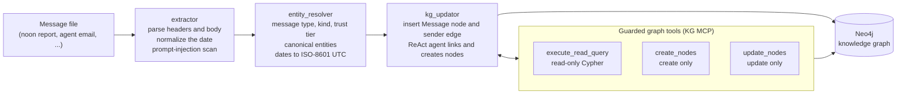
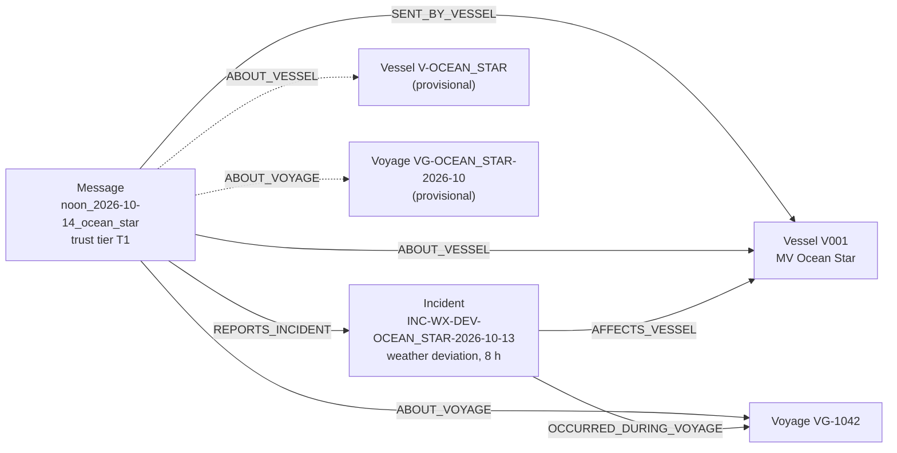

# Message Ingestion: Sample Run

What the message loader produces for an operational message: the input, what the pipeline extracted, the nodes and edges it wrote to the knowledge graph, and the LangSmith trace of the run. Three Master's noon reports are shown.

**Related:** [message loader](kg_loader/message_loader/README.md) · [ingestion pipeline design](design/pipeline_architecture_design.md) · [knowledge graph schema](design/kg_schema_design.md) · [evaluation execution log](../ai_agent/docs/EVALUATION_EXECUTIONS.md) · [write-up](../ai_agent/docs/WRITEUP.md)

## The run

The three messages are the last three of one batch run, `run_20261102_082541_07e978`: 15 messages from `synthetic_dataset/data/messages/core`, all 15 succeeded, 1 prompt injection quarantined, 14 domain nodes created, 4 existing nodes updated, 69 edges attached, 1,593 s in total. (Batch figures are from that run's ingestion report, a local file that is not committed.)

Each message goes through a three-node LangGraph workflow:

1. **extractor** parses the RFC headers and body, normalizes the date, and scans for prompt injection.
2. **entity_resolver** classifies the sender (message type, kind, trust tier T1 to T4) and rewrites entities and time expressions to canonical IDs and ISO-8601 UTC.
3. **kg_updator** inserts the `Message` node and its sender edge, then runs a ReAct agent with the guarded graph tools (`execute_read_query`, `create_nodes`, `update_nodes`) to link the message to the graph and create anything missing.



| Message | Trust tier | Result | Created / updated / edges | Duration | Tokens | Cost | LangSmith trace |
| :-- | :-: | :-: | :-: | --: | --: | --: | :-- |
| `noon_2026-10-02_ocean_pearl` | T1 | SUCCESS | 1 / 0 / 4 | 105 s | 48,197 | $0.0078 | [open trace](https://apac.smith.langchain.com/public/276e1be6-e85e-46a3-b683-e496593d3a9b/r/01a19b6f-46d0-76d8-8c78-81d53e915b1d?start_time=2026-11-02T08%3A45%3A23.536951Z) |
| `noon_2026-10-06_ocean_star` | T1 | SUCCESS | 1 / 0 / 3 | 117 s | 44,086 | $0.0074 | [open trace](https://apac.smith.langchain.com/public/fa3f3fd9-5684-4757-930d-8aeca38d7014/r/01a19b70-e217-7067-a908-bdf65bee33a5?start_time=2026-11-02T08%3A47%3A08.823286Z) |
| `noon_2026-10-14_ocean_star` | T1 | SUCCESS | 3 / 0 / 7 | 189 s | 80,932 | $0.0103 | [open trace](https://apac.smith.langchain.com/public/959916b6-f075-4ce7-abf2-861c5ac977ef/r/01a19b72-ab18-7645-80ee-0fcd9bf5b38b?start_time=2026-11-02T08%3A49%3A05.816096Z) |

The traces are public LangSmith share links and show every step of the run (68, 58 and 88 child runs: the model calls and each graph-tool call). This page shows each run's inputs and outputs and the agent's own summary.

---

## 1. Ocean Pearl noon report, 2 Oct

**Input** (`synthetic_dataset/data/messages/core/noon_2026-10-02_ocean_pearl.txt`)

```text
From: Master, M/V OCEAN PEARL
To: operations@ops-desk.example
Date: 2026-10-02 06:00 UTC
Subject: NOON REPORT - OCEAN PEARL - VOY 1050

Position 23-10N 060-02E. HT cooling water outlet temperature high alarm on ME at 0340 LT; load reduced for 6 hours while engineers inspected
seawater cooling pump. Pump seal leaking, temporary repair made, permanent repair at next port. Approx 6 h lost.
Master
```

**Classified as:** Master's report, `noon_report`, trust tier **T1**, sender edge `SENT_BY_VESSEL` to vessel *MV Ocean Pearl*. No prompt injection found.

**Dates resolved**

| Text | ISO-8601 UTC | Type |
| :-- | :-- | :-- |
| `0340 LT` | 2026-10-01T23:40:00Z | incident start |

**Node created**

| Label | ID | Properties |
| :-- | :-- | :-- |
| Incident | `INC-20261001-OceanPearl-HTCW` | type `equipment_breakdown`, component seawater cooling pump seal, delay 6 h, start 2026-10-01T23:40:00Z, status "temporary repair completed; permanent repair pending at next port" |

**Edges added**

| Relationship | Target | Temporal | Event time (UTC) |
| :-- | :-- | :-: | :-- |
| `REPORTS_INCIDENT` | Incident `INC-20261001-OceanPearl-HTCW` | past | 2026-10-01T23:40:00Z |
| `ABOUT_VESSEL` | Vessel `V004` | past | |
| `AFFECTS_VESSEL` | Vessel `V004` | past | |
| `ABOUT_VOYAGE` | Voyage `VG-1050` | past | 2026-10-01T23:40:00Z |

The run log lists `AFFECTS_VESSEL` with the message's edges; in the graph it is attached to the Incident node, not to the message.

**Agent summary (excerpt):** "The voyage VG-1050 already has `recorded_delay_hours: 6.0`, which matches the message's reported ~6 hours lost. The incident I created also records 6 delay hours, corroborating the voyage delay record."

---

## 2. Ocean Star noon report, 6 Oct

**Input** (`noon_2026-10-06_ocean_star.txt`)

```text
From: Master, M/V OCEAN STAR
To: operations@ops-desk.example
Date: 2026-10-06 06:00 UTC
Subject: NOON REPORT - M/V OCEAN STAR - VOY 1042

Position 07-12N 078-40E. Course 285. Avg speed last 24h 9.8 kn (planned 17.5).
Main engine stopped 0130-1330 LT due to seawater cooling pump mechanical seal failure. Spare seal fitted, ME restarted and tested OK.
Time lost: 12 hours. Engineers monitoring cooling water temperatures.
Master
```

**Classified as:** Master's report, `noon_report`, **T1**, sender edge `SENT_BY_VESSEL` to *MV Ocean Star*. No prompt injection found.

**Dates resolved**

| Text | ISO-8601 UTC | Type |
| :-- | :-- | :-- |
| `last 24h` | 2026-10-05T06:00:00Z | observation |
| `0130-1330 LT` | 2026-10-05T19:30:00Z | incident start |
| `0130-1330 LT` | 2026-10-06T07:30:00Z | incident end |
| `12 hours` | 2026-10-05T19:30:00Z | observation |

**Node created**

| Label | ID | Properties |
| :-- | :-- | :-- |
| Incident | `INC-OS-2026-1005` | type `equipment_failure`, component seawater cooling pump, delay 12 h, 2026-10-05T19:30:00Z to 2026-10-06T07:30:00Z, status `resolved` |

**Edges added**

| Relationship | Target | Temporal | Event time (UTC) |
| :-- | :-- | :-: | :-- |
| `ABOUT_VESSEL` | Vessel `V001` | past | |
| `REPORTS_INCIDENT` | Incident `INC-OS-2026-1005` | past | 2026-10-05T19:30:00Z |
| `ABOUT_VOYAGE` | Voyage `VG-1042` | past | 2026-10-06T06:00:00Z |

**Agent summary (excerpt):** "Incident INC-OS-2026-1005, created as an *unlogged disruption* since no pre-existing incident matched this message ... Linked based on the subject line 'VOY 1042'."

---

## 3. Ocean Star noon report, 14 Oct

**Input** (`noon_2026-10-14_ocean_star.txt`)

```text
From: Master, MV Ocean Star
To: operations@ops-desk.example
Date: 2026-10-14 06:00 UTC
Subject: Noon report Ocean Star 14 Oct

Position 13-55N 052-10E. Deviation south of low-pressure system in Arabian Sea completed, back on planned route 2200 UTC 13 Oct.
Estimated time lost due to weather deviation: 8 hours. No damage. Speed now 17.2 kn.
Master
```

**Classified as:** Master's report, `noon_report`, **T1**, sender edge `SENT_BY_VESSEL` to *MV Ocean Star*. No prompt injection found.

**Dates resolved**

| Text | ISO-8601 UTC | Type |
| :-- | :-- | :-- |
| `2200 UTC 13 Oct` | 2026-10-13T22:00:00Z | incident end |
| `now` | 2026-10-14T06:00:00Z | observation |

**Nodes created**

| Label | ID | Properties |
| :-- | :-- | :-- |
| Incident | `INC-WX-DEV-OCEAN_STAR-2026-10-13` | weather deviation, delay 8 h, 2026-10-13T00:00:00Z to 2026-10-13T22:00:00Z, status `resolved` |
| Vessel | `V-OCEAN_STAR` | name "Ocean Star", type `cargo_vessel` |
| Voyage | `VG-OCEAN_STAR-2026-10` | vessel name "Ocean Star", status `in_progress` |

**Edges added**

| Relationship | Target | Temporal | Event time (UTC) |
| :-- | :-- | :-: | :-- |
| `ABOUT_VOYAGE` | Voyage `VG-OCEAN_STAR-2026-10` | current | 2026-10-14T06:00:00Z |
| `ABOUT_VESSEL` | Vessel `V-OCEAN_STAR` | current | |
| `REPORTS_INCIDENT` | Incident `INC-WX-DEV-OCEAN_STAR-2026-10-13` | past | 2026-10-13T22:00:00Z |
| `ABOUT_VOYAGE` | Voyage `VG-1042` | current | 2026-10-14T06:00:00Z |
| `ABOUT_VESSEL` | Vessel `V001` | current | |
| `AFFECTS_VESSEL` | Vessel `V001` | past | 2026-10-13T22:00:00Z |
| `OCCURRED_DURING_VOYAGE` | Voyage `VG-1042` | past | 2026-10-13T22:00:00Z |

As above, `AFFECTS_VESSEL` and `OCCURRED_DURING_VOYAGE` are attached to the Incident node in the graph. The result, as it stands in Neo4j (dashed lines are the provisional vessel and voyage nodes the agent also created for the same vessel and voyage):



**Agent summary (excerpt):** "`[:ABOUT_VESSEL]` to V001 ... the canonical vessel already present in the graph ... `[:ABOUT_VOYAGE]` to VG-1042, the vessel's active voyage (departed 2026-09-29, status 'Delayed') ... I created a new Incident node: INC-WX-DEV-OCEAN_STAR-2026-10-13."

---

## Reproduce

```powershell
uv run python -m knowledge_graph.kg_loader.message_loader.runner --messages-dir synthetic_dataset/data/messages/core
```

This needs Neo4j, the Azure model settings in `.env`, and about half an hour for the 15 `core/` messages. The pre-built dump already contains this run's result.
