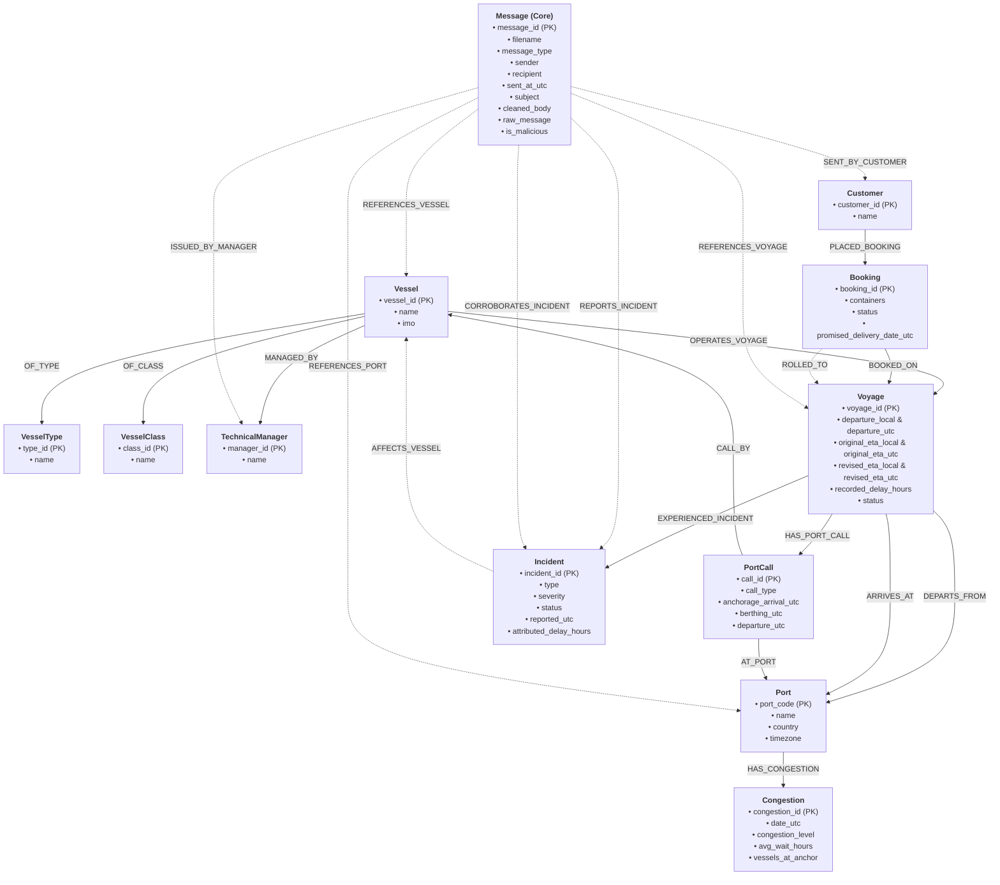

# Maritime Domain Knowledge Graph Schema Specification

## 1. Schema Overview

The Maritime Operations Knowledge Graph integrates structured operational tabular data (fleet master data, voyages, port calls, congestion, incidents, cargo bookings) with unstructured operational communications (noon reports, port agent logs, technical bulletins, customer inquiries).

All timestamps and date fields are standardized to **UTC** (ISO 8601: `YYYY-MM-DDTHH:MM:SSZ` or Date: `YYYY-MM-DD`). Local port timestamps from tabular sources are converted to UTC using the IANA timezone of the respective port.

---

## 2. Graph Node Definitions & Attributes

The schema comprises **12 core node labels**:

### 1. `Vessel`
Represents an individual physical vessel in the fleet.
* **Source Table**: `vessels.csv`
* **Primary Identifier**: `vessel_id` (e.g., `"V001"`)
* **Attributes**:
  * `vessel_id` (STRING, Unique PK): Internal vessel identifier.
  * `name` (STRING): Vessel name (e.g., `"MV Ocean Star"`).
  * `imo` (INTEGER, Unique): International Maritime Organization 7-digit identifier (e.g., `9876543`).
* **Graph Outgoing Edges**:
  * `[:OF_TYPE]->(:VesselType)`
  * `[:OF_CLASS]->(:VesselClass)`
  * `[:MANAGED_BY]->(:TechnicalManager)`
  * `[:OPERATES_VOYAGE]->(:Voyage)`

---

### 2. `VesselType`
Represents the functional classification or vessel category.
* **Source Table**: Extracted from `vessels.csv` (`type` column).
* **Primary Identifier**: `type_id` / `name` (e.g., `"Container ship"`, `"Feeder"`, `"Bulk carrier"`)
* **Attributes**:
  * `type_id` (STRING, Unique PK): Normalized type identifier (e.g., `"CONTAINER_SHIP"`, `"FEEDER"`, `"BULK_CARRIER"`).
  * `name` (STRING): Display name (e.g., `"Container ship"`).
  * `description` (STRING, Optional): Descriptive summary of vessel operational category.

---

### 3. `VesselClass`
Represents the structural hull design, series, and equipment architecture. Critical for analyzing sister-ship fleet patterns and recurring mechanical faults (e.g., cooling pump failures across *Meridian 8500* vessels).
* **Source Table**: Extracted from `vessels.csv` (`vessel_class` column).
* **Primary Identifier**: `class_id` / `name` (e.g., `"Meridian 8500"`, `"Atlas 6000"`, `"Kestrel 4000"`, `"Coastal 1700"`, `"Titan Bulk 82"`)
* **Attributes**:
  * `class_id` (STRING, Unique PK): Unique class identifier.
  * `name` (STRING): Class designation name.
  * `nominal_capacity_teu` (INTEGER, Optional): Standard container capacity (TEU) or deadweight tonnage.

---

### 4. `TechnicalManager`
Represents the third-party ship management company responsible for technical fleet superintendency, maintenance schedules, bulletins, and engineering operations.
* **Source Table**: Extracted from `vessels.csv` (`technical_manager` column).
* **Primary Identifier**: `manager_id` / `name` (e.g., `"Harbourline Ship Management"`, `"Nordwave Marine"`, `"Eastpoint Technical Services"`, `"Sulamar Gestão Naval"`, `"Bluefin Fleet Services"`)
* **Attributes**:
  * `manager_id` (STRING, Unique PK): Normalized slug/identifier.
  * `name` (STRING): Full corporate entity name.
  * `contact_email` (STRING, Optional): Management operations email domain or contact.

---

### 5. `Port`
Represents a seaport terminal hub with defined maritime boundaries, anchorages, and local operational timezones.
* **Source Table**: `ports.csv`
* **Primary Identifier**: `port_code` (e.g., `"SGSIN"`, `"NLRTM"`, `"DEHAM"`)
* **Attributes**:
  * `port_code` (STRING, Unique PK): UN/LOCODE 5-letter code (e.g., `"NLRTM"`).
  * `name` (STRING): Formal port name (e.g., `"Port of Rotterdam"`).
  * `country` (STRING): Country name (e.g., `"Netherlands"`).
  * `timezone` (STRING): IANA timezone identifier (e.g., `"Europe/Amsterdam"`, `"Asia/Singapore"`).
* **Graph Outgoing Edges**:
  * `[:HAS_CONGESTION]->(:Congestion)`

---

### 6. `Voyage`
Represents an individual commercial voyage transit executed by a vessel between an origin port and a destination port.
* **Source Table**: `voyages.csv`
* **Primary Identifier**: `voyage_id` (e.g., `"VG-1042"`)
* **Attributes** (Both UTC and local time fields retained):
  * `voyage_id` (STRING, Unique PK): Voyage code.
  * `departure_utc` (DATETIME): Departure timestamp in UTC (converted from `departure_local` using origin port timezone).
  * `departure_local` (STRING / DATETIME): Original departure in origin port local time.
  * `original_eta_utc` (DATETIME): Contractual ETA in UTC (converted from `original_eta_local` using destination port timezone).
  * `original_eta_local` (STRING / DATETIME): Contractual ETA in destination port local time.
  * `revised_eta_utc` (DATETIME): Revised ETA in UTC (converted from `revised_eta_local` using destination port timezone).
  * `revised_eta_local` (STRING / DATETIME): Revised ETA in destination port local time.
  * `berth_window_start_utc` (DATETIME): Berth window opening in UTC (converted using destination port timezone).
  * `berth_window_start_local` (STRING / DATETIME): Berth window opening in destination port local time.
  * `berth_window_end_utc` (DATETIME): Berth window closing in UTC (converted using destination port timezone).
  * `berth_window_end_local` (STRING / DATETIME): Berth window closing in destination port local time.
  * `status` (STRING): Lifecycle status (`"Completed"`, `"Delayed"`, `"Scheduled"`, `"On schedule"`).
  * `recorded_delay_hours` (FLOAT): Operations-recorded delay hours (`revised_eta - original_eta`).
* **Graph Outgoing Edges**:
  * `[:OPERATED_BY]->(:Vessel)` (or inverse `(:Vessel)-[:OPERATES_VOYAGE]->(:Voyage)`)
  * `[:DEPARTS_FROM]->(:Port)` (Origin port)
  * `[:ARRIVES_AT]->(:Port)` (Destination port)
  * `[:HAS_PORT_CALL]->(:PortCall)`
  * `[:EXPERIENCED_INCIDENT]->(:Incident)`

---

### 7. `PortCall`
Represents physical terminal and anchorage milestones recorded during a vessel's stop at a port.
* **Source Table**: `port_calls.csv`
* **Primary Identifier**: `call_id` (e.g., `"PC-7001"`)
* **Attributes** (Native UTC in dataset):
  * `call_id` (STRING, Unique PK): Port call event identifier.
  * `call_type` (STRING): Event type (`"Departure"` or `"Arrival"`).
  * `anchorage_arrival_utc` (DATETIME, Nullable): Timestamp vessel entered port outer anchorage.
  * `berth_scheduled_utc` (DATETIME, Nullable): Assigned terminal berthing slot.
  * `berthing_utc` (DATETIME, Nullable): Actual timestamp vessel made fast alongside berth.
  * `departure_utc` (DATETIME, Nullable): Timestamp vessel unmoored and departed berth.
  * `anchorage_wait_hours` (FLOAT, Computed): Duration spent waiting at anchor (`berthing_utc - anchorage_arrival_utc`).
  * `port_stay_hours` (FLOAT, Computed): Total port turnaround duration (`departure_utc - berthing_utc`).
* **Graph Outgoing Edges**:
  * `[:AT_PORT]->(:Port)`
  * `[:PART_OF_VOYAGE]->(:Voyage)`
  * `[:CALL_BY]->(:Vessel)`

---

### 8. `Incident`
Represents an unexpected operational disruption, mechanical defect, weather diversion, regulatory delay, or labor stoppage.
* **Source Table**: `incidents.csv`
* **Primary Identifier**: `incident_id` (e.g., `"INC-201"`)
* **Attributes**:
  * `incident_id` (STRING, Unique PK): Incident identifier.
  * `type` (STRING): Incident category (`"Engine cooling fault"`, `"Adverse weather / rerouting"`, `"Customs documentation query"`, `"Bunkering delay"`, `"Hull fouling / speed loss"`, etc.).
  * `status` (STRING): Investigation status (`"Confirmed"`, `"Reported"`, `"Under review"`, `"Dismissed"`).
  * `severity` (STRING): Impact classification (`"Low"`, `"Medium"`, `"High"`, `"Unknown"`).
  * `reported_utc` (DATETIME): Incident logged timestamp in UTC.
  * `source` (STRING): Reporting channel (`"Master's report"`, `"Crew message"`, `"Agent email"`, `"Technical manager"`, `"Port agent"`).
  * `attributed_delay_hours` (FLOAT, Nullable): Official delay duration allocated to this specific root cause.
* **Graph Outgoing Edges**:
  * `[:OCCURRED_ON_VOYAGE]->(:Voyage)`
  * `[:AFFECTS_VESSEL]->(:Vessel)` (Derived shortcut)

---

### 9. `Congestion`
Represents daily port-wide water-side and terminal bottleneck indicators.
* **Source Table**: `congestion.csv`
* **Primary Identifier**: `congestion_id` (Composite key: `CONG_<port>_<date>`, e.g., `"CONG_SGSIN_2026-09-17"`)
* **Attributes**:
  * `congestion_id` (STRING, Unique PK): Composite key.
  * `date_utc` (DATE / STRING): Observation date in UTC (`"YYYY-MM-DD"`).
  * `congestion_level` (STRING): Category (`"Low"`, `"Moderate"`, `"High"`).
  * `avg_wait_hours` (FLOAT): Port-wide average anchorage waiting time before berthing.
  * `vessels_at_anchor` (INTEGER): Number of ships queued at outer anchorage.
  * `source` (STRING): Feed source (`"Port authority feed"`).
* **Graph Outgoing Edges**:
  * `[:RECORDED_AT]->(:Port)` (or inverse `(:Port)-[:HAS_CONGESTION]->(:Congestion)`)

---

### 10. `Booking`
Represents a customer commercial freight allocation booked aboard a voyage.
* **Source Table**: `bookings.csv`
* **Primary Identifier**: `booking_id` (e.g., `"BK-50001"`)
* **Attributes**:
  * `booking_id` (STRING, Unique PK): Booking reference number.
  * `containers` (INTEGER): Volume of cargo containers / TEUs.
  * `status` (STRING): Status (`"Confirmed"`, `"Cancelled"`, `"Rolled to VG-1107"`, `"Rolled to next sailing"`).
  * `promised_delivery_date_utc` (DATE / STRING): Contractual delivery deadline in UTC (`"YYYY-MM-DD"`).
  * `is_rolled` (BOOLEAN): Flag indicating if booking was pushed to a later sailing.
* **Graph Outgoing Edges**:
  * `[:BOOKED_BY]->(:Customer)` (or inverse `(:Customer)-[:PLACED_BOOKING]->(:Booking)`)
  * `[:BOOKED_ON]->(:Voyage)` (Initial assigned voyage)
  * `[:ROLLED_TO]->(:Voyage)` (Re-assigned voyage if rolled)

---

### 11. `Customer`
Represents an enterprise shipper, freight forwarder, or cargo owner.
* **Source Table**: Extracted from `bookings.csv` (`customer` column).
* **Primary Identifier**: `customer_id` / `name` (e.g., `"Halden Retail"`, `"Kaimon Electronics"`, `"Verdant Foods"`, `"Lumio Home"`, `"Petra Chemicals"`, `"Northgate Auto"`)
* **Attributes**:
  * `customer_id` (STRING, Unique PK): Normalized identifier slug.
  * `name` (STRING): Display customer name.
  * `industry_segment` (STRING, Optional): Inferred customer segment (`"Electronics"`, `"Retail"`, `"Perishables"`, `"Chemicals"`, `"Automotive"`).

---

### 12. `Message`
Represents unstructured operational communications scoped strictly to the core dataset (`messages/core/*.txt`). Preserves narrative evidence, operational provenance, and conflict reconciliation.
* **Source Files**: `messages/core/*.txt` (15 core messages)
* **Primary Identifier**: `message_id` (e.g., `"noon_2026-10-06_ocean_star"`)
* **Attributes**:
  * `message_id` (STRING, Unique PK): Unique identifier derived from filename (e.g., `"noon_2026-10-06_ocean_star"`).
  * `filename` (STRING): Full filename (e.g., `"noon_2026-10-06_ocean_star.txt"`).
  * `message_type` (STRING): Standardized operational source type directly mapping to incident sources:
    * `"Master report"` (maps to `Master's report` in `incidents.csv`)
    * `"Crew message"` (maps to `Crew message` in `incidents.csv`)
    * `"Agent email"` (maps to `Agent email` in `incidents.csv`)
    * `"Port agent"` (maps to `Port agent` in `incidents.csv`)
    * `"Technical manager"` (maps to `Technical manager` in `incidents.csv`)
  * `sender` (STRING): Value from `From:` header.
  * `recipient` (STRING): Value from `To:` header.
  * `sent_at_utc` (DATETIME): Parsed header timestamp in UTC.
  * `subject` (STRING): Value from `Subject:` header.
  * `cleaned_body` (STRING): Sanitized and normalized body text with whitespace stripped and signatures parsed.
  * `raw_message` (STRING): Verbatim complete text of the message file as received.
  * `is_malicious` (BOOLEAN): Security detection flag for prompt injection / adversarial manipulation attempts (e.g., in `fwd_2026-10-25_status_request.txt`).
* **Graph Outgoing Edges**:
  * `[:REFERENCES_VESSEL]->(:Vessel)`
  * `[:REFERENCES_VOYAGE]->(:Voyage)`
  * `[:REFERENCES_PORT]->(:Port)`
  * `[:REPORTS_INCIDENT]->(:Incident)`
  * `[:CORROBORATES_INCIDENT]->(:Incident)`
  * `[:SENT_BY_CUSTOMER]->(:Customer)`
  * `[:ISSUED_BY_MANAGER]->(:TechnicalManager)`

---

## 3. Knowledge Graph Edge (Relationship) Matrix

| Edge Relationship | Source Node | Target Node | Cardinality | Semantic Description & Source |
| :--- | :--- | :--- | :---: | :--- |
| `[:OF_TYPE]` | `Vessel` | `VesselType` | N : 1 | Categorizes vessel (from `vessels.csv.type`). |
| `[:OF_CLASS]` | `Vessel` | `VesselClass` | N : 1 | Specifies hull / design class (from `vessels.csv.vessel_class`). |
| `[:MANAGED_BY]` | `Vessel` | `TechnicalManager` | N : 1 | Specifies technical superintendent (from `vessels.csv.technical_manager`). |
| `[:OPERATES_VOYAGE]` | `Vessel` | `Voyage` | 1 : N | Vessel assigned to execute the voyage (from `voyages.csv.vessel_id`). |
| `[:DEPARTS_FROM]` | `Voyage` | `Port` | N : 1 | Origin port of the voyage (from `voyages.csv.origin`). |
| `[:ARRIVES_AT]` | `Voyage` | `Port` | N : 1 | Scheduled destination port (from `voyages.csv.destination`). |
| `[:HAS_PORT_CALL]` | `Voyage` | `PortCall` | 1 : N | Milestone stops during the voyage (from `port_calls.csv.voyage_id`). |
| `[:AT_PORT]` | `PortCall` | `Port` | N : 1 | Port facility where call occurs (from `port_calls.csv.port`). |
| `[:CALL_BY]` | `PortCall` | `Vessel` | N : 1 | Vessel executing the call (from `port_calls.csv.vessel_id`). |
| `[:HAS_CONGESTION]` | `Port` | `Congestion` | 1 : N | Daily congestion status logs for a port (from `congestion.csv.port`). |
| `[:EXPERIENCED_INCIDENT]` | `Voyage` | `Incident` | 1 : N | Incidents recorded on this voyage (from `incidents.csv.voyage_id`). |
| `[:AFFECTS_VESSEL]` | `Incident` | `Vessel` | N : 1 | Vessel impacted by the disruption (derived via Voyage). |
| `[:PLACED_BOOKING]` | `Customer` | `Booking` | 1 : N | Shipper who booked cargo space (from `bookings.csv.customer`). |
| `[:BOOKED_ON]` | `Booking` | `Voyage` | N : 1 | Voyage scheduled to carry containers (from `bookings.csv.voyage_id`). |
| `[:ROLLED_TO]` | `Booking` | `Voyage` | N : 1 | Subsequent voyage if cargo was rolled (from `bookings.csv.status`). |
| `[:REFERENCES_VESSEL]` | `Message` | `Vessel` | N : N | Message mentions vessel by name or IMO. |
| `[:REFERENCES_VOYAGE]` | `Message` | `Voyage` | N : N | Message references voyage by ID or number. |
| `[:REFERENCES_PORT]` | `Message` | `Port` | N : N | Message references a port name or code. |
| `[:REPORTS_INCIDENT]` | `Message` | `Incident` | N : N | Message that initially reported an incident. |
| `[:CORROBORATES_INCIDENT]`| `Message` | `Incident` | N : N | Authoritative update revising or confirming an incident (e.g., noon report revising delay hours). |
| `[:SENT_BY_CUSTOMER]` | `Message` | `Customer` | N : 1 | Customer communication / status request. |
| `[:ISSUED_BY_MANAGER]` | `Message` | `TechnicalManager`| N : 1 | Technical service bulletin issued across fleet. |

---

## 4. UTC Timezone Normalization Rules

In accordance with the DB requirement **"We gonna keep the UTC timezone in the DB"**:

1. **Origin Timestamps (`departure_local`)**:
   * Lookup `timezone` from `ports.csv` for the voyage's `origin` port code (e.g., `SGSIN` -> `"Asia/Singapore"`).
   * Localize the timestamp string to origin timezone and convert to UTC:
     $$\text{departure\_utc} = \text{astimezone}(\text{localize}(\text{departure\_local}, \text{TZ}_{\text{origin}}), \text{UTC})$$

2. **Destination Timestamps (`original_eta_local`, `revised_eta_local`, `berth_window_start_local`, `berth_window_end_local`)**:
   * Lookup `timezone` from `ports.csv` for the voyage's `destination` port code (e.g., `NLRTM` -> `"Europe/Amsterdam"`).
   * Localize each timestamp string to destination timezone and convert to UTC:
     $$\text{eta\_utc} = \text{astimezone}(\text{localize}(\text{eta\_local}, \text{TZ}_{\text{destination}}), \text{UTC})$$

3. **Port Calls & Incidents (`_utc`)**:
   * Already recorded with `Z` suffix (UTC ISO 8601). Ingested directly into `DATETIME` properties.

4. **Congestion & Bookings Dates**:
   * Standardized to ISO Date strings (`YYYY-MM-DD`) or UTC midnight datetime (`YYYY-MM-DDT00:00:00Z`).

5. **Operational Messages**:
   * Header `Date:` lines (e.g., `2026-10-06 06:00 UTC`) are parsed and converted to ISO 8601 UTC datetimes.

---

## 5. Schema Graph Visualization (Mermaid)



---

## 6. Cypher Schema Constraints & Indexes (Neo4j / Memgraph DDL)

```cypher
// Unique Node Identifier Constraints
CREATE CONSTRAINT unique_vessel_id IF NOT EXISTS FOR (v:Vessel) REQUIRE v.vessel_id IS UNIQUE;
CREATE CONSTRAINT unique_vessel_imo IF NOT EXISTS FOR (v:Vessel) REQUIRE v.imo IS UNIQUE;
CREATE CONSTRAINT unique_vessel_type IF NOT EXISTS FOR (t:VesselType) REQUIRE t.type_id IS UNIQUE;
CREATE CONSTRAINT unique_vessel_class IF NOT EXISTS FOR (c:VesselClass) REQUIRE c.class_id IS UNIQUE;
CREATE CONSTRAINT unique_tech_manager IF NOT EXISTS FOR (m:TechnicalManager) REQUIRE m.manager_id IS UNIQUE;
CREATE CONSTRAINT unique_port_code IF NOT EXISTS FOR (p:Port) REQUIRE p.port_code IS UNIQUE;
CREATE CONSTRAINT unique_voyage_id IF NOT EXISTS FOR (voy:Voyage) REQUIRE voy.voyage_id IS UNIQUE;
CREATE CONSTRAINT unique_call_id IF NOT EXISTS FOR (pc:PortCall) REQUIRE pc.call_id IS UNIQUE;
CREATE CONSTRAINT unique_incident_id IF NOT EXISTS FOR (i:Incident) REQUIRE i.incident_id IS UNIQUE;
CREATE CONSTRAINT unique_congestion_id IF NOT EXISTS FOR (cg:Congestion) REQUIRE cg.congestion_id IS UNIQUE;
CREATE CONSTRAINT unique_booking_id IF NOT EXISTS FOR (b:Booking) REQUIRE b.booking_id IS UNIQUE;
CREATE CONSTRAINT unique_customer_id IF NOT EXISTS FOR (c:Customer) REQUIRE c.customer_id IS UNIQUE;
CREATE CONSTRAINT unique_message_id IF NOT EXISTS FOR (msg:Message) REQUIRE msg.message_id IS UNIQUE;

// Performance Indexes for Operational Traversal & Temporal Search
CREATE INDEX voyage_arrival_utc_idx IF NOT EXISTS FOR (voy:Voyage) ON (voy.revised_eta_utc);
CREATE INDEX incident_reported_utc_idx IF NOT EXISTS FOR (i:Incident) ON (i.reported_utc);
CREATE INDEX congestion_date_utc_idx IF NOT EXISTS FOR (cg:Congestion) ON (cg.date_utc);
CREATE INDEX booking_delivery_date_idx IF NOT EXISTS FOR (b:Booking) ON (b.promised_delivery_date_utc);
CREATE INDEX message_sent_at_utc_idx IF NOT EXISTS FOR (msg:Message) ON (msg.sent_at_utc);
```
