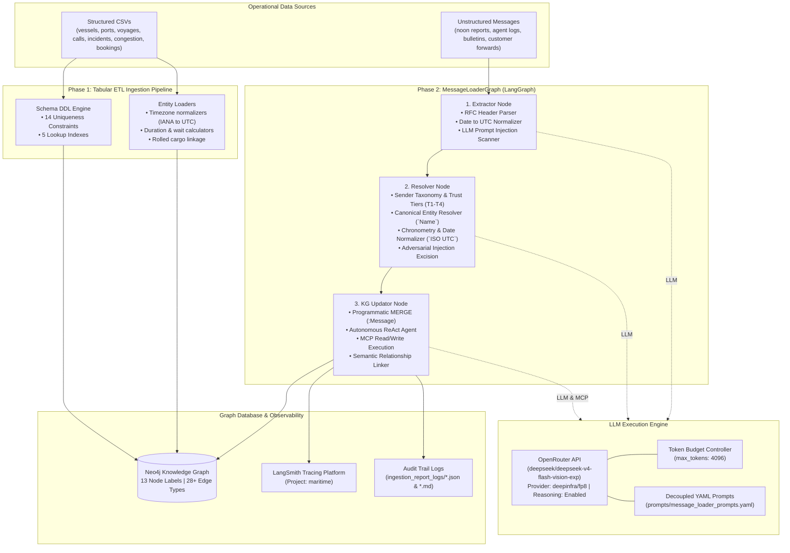
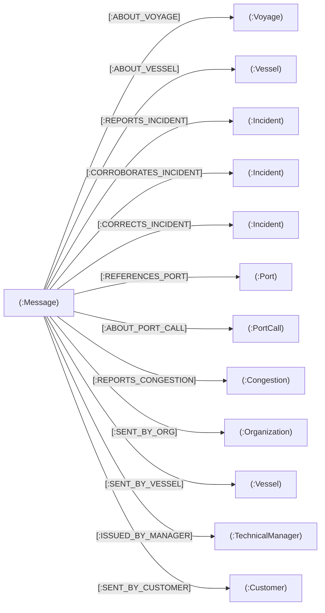
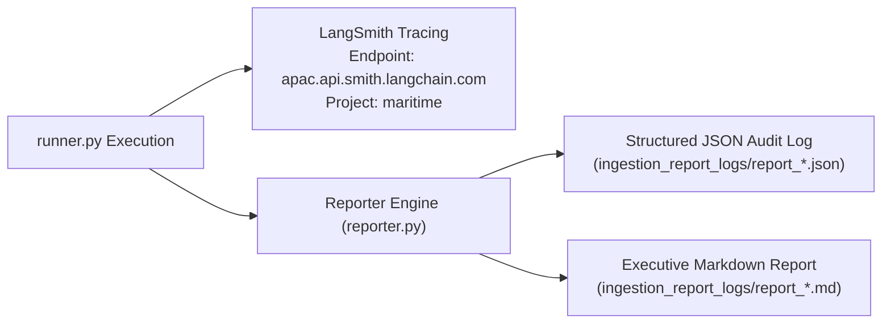

# Maritime Operations Knowledge Graph: Pipeline Design & Architecture

---

## 1. Executive Summary & System Objectives

The **Maritime Operations Knowledge Graph & Assistant** provides a unified intelligence and reasoning platform for maritime commercial operations, technical ship management, delay root-cause analysis, and cargo tracking.

The operational reality of maritime shipping is characterized by a fundamental dichotomy:
1. **Structured Operational Telemetry**: Tabular data capturing fleet master records, voyage schedules, port calls, historical weather/terminal congestion, and container bookings.
2. **Unstructured Operational Communications**: Time-critical, human-generated communications (vessel noon reports, port agent status summaries, technical fleet bulletins, bridge VHF/chat relays, and customer status requests).

Crucially, unstructured communications contain vital early warnings and ground-truth corrections (e.g. unexpected mechanical breakdowns, customs holds, port queue lineups) that are frequently missing or delayed in formal tabular databases. Furthermore, operational messages are subject to adversarial security risks, including deliberate prompt injection and fraudulent delay falsification attempts.

This document specifies the end-to-end design, system topology, component interactions, security controls, and operational workflows of the ingestion architecture.

---

## 2. End-to-End System Topology



---

## 3. Tabular Ingestion Pipeline Architecture (Phase 1)

The structured ingestion pipeline operates as a deterministic, constraint-first ETL framework implemented in `knowledge_graph/kg_loader/`:

### 3.1 Schema & Constraint Engine (`schema.py`)
Prior to any data write, the engine enforces 14 uniqueness constraints and 5 operational indexes in Neo4j to guarantee referential integrity and $O(1)$ key lookups:
* `unique_port_code` on `Port.port_code`
* `unique_vessel_id` on `Vessel.vessel_id`
* `unique_vessel_imo` on `Vessel.imo`
* `unique_vessel_type_id` on `VesselType.type_id`
* `unique_vessel_class_id` on `VesselClass.class_id`
* `unique_tech_manager_id` on `TechnicalManager.manager_id`
* `unique_voyage_id` on `Voyage.voyage_id`
* `unique_port_call_id` on `PortCall.call_id`
* `unique_incident_id` on `Incident.incident_id`
* `unique_congestion_id` on `Congestion.congestion_id`
* `unique_booking_id` on `Booking.booking_id`
* `unique_customer_id` on `Customer.customer_id`
* `unique_message_id` on `Message.message_id`
* `unique_org_id` on `Organization.org_id`

### 3.2 Timezone Normalization & Metrics Computation
Local timestamps across global ports are resolved to UTC using native IANA timezone databases (`pytz` / `tzdata`):
$$\text{Timestamp}_{\text{UTC}} = \text{LocalToUTC}(\text{Timestamp}_{\text{Local}}, \text{Port}_{\text{Timezone}})$$
Derived operational metrics are calculated dynamically:
$$\text{Wait Hours} = \frac{\text{Berthing}_{\text{UTC}} - \text{AnchorageArrival}_{\text{UTC}}}{3600}$$
$$\text{Stay Hours} = \frac{\text{Departure}_{\text{UTC}} - \text{Berthing}_{\text{UTC}}}{3600}$$

---

## 4. Operational Message Ingestion Architecture (`MessageLoaderGraph` - Phase 2)

Unstructured messages are ingested via an idempotent, 3-node **LangGraph** state machine. Each message progresses through a rigorous sequential lifecycle:

```mermaid
stateDiagram-v2
    [*] --> ExtractorNode: Raw *.txt Message File
    
    state ExtractorNode {
        direction TB
        RFC: Parse RFC 2822 Headers
        UTC: Convert Header Date to ISO 8601 UTC
        Scan: LLM Adversarial Injection Scanner
        RFC --> UTC
        UTC --> Scan
    }
    
    ExtractorNode --> ResolverNode: Extracted State + Security Assessment
    
    state ResolverNode {
        direction TB
        Sender: Classify Sender & Trust Tier (T1-T4)
        Entities: Canonical Entity Replacement
        Dates: Resolve Temporal Expressions to ISO 8601 UTC
        Excise: Strip Malicious Injections & Banners
        Sender --> Entities
        Entities --> Dates
        Dates --> Excise
    }
    
    ResolverNode --> KGUpdatorNode: Standardized State + Cleaned Body
    
    state KGUpdatorNode {
        direction TB
        MergeMsg: Programmatic MERGE (:Message) Node
        LinkSender: Idempotent MERGE (:SENT_BY_*) Edge
        ReActAgent: Spawn ReAct Agent with MCP Tools
        AgentMutations: Execute Cypher & Update Domain Records
        AttachEdges: Link Semantic Edges with Temporal Constraints
        MergeMsg --> LinkSender
        LinkSender --> ReActAgent
        ReActAgent --> AgentMutations
        AgentMutations --> AttachEdges
    }
    
    KGUpdatorNode --> AuditReporter: Mutation State & Trace
    
    state AuditReporter {
        GenJSON: Generate report_*.json
        GenMD: Generate report_*.md
        StreamLangSmith: Stream Traces to LangSmith
        GenJSON --> GenMD
        GenMD --> StreamLangSmith
    }
    
    AuditReporter --> [*]: Ingestion Complete
```



---

### 4.1 Node 1: Extractor Node (`nodes/extractor.py`)

#### Responsibilities:
1. **RFC Header Parsing**: Splits raw ASCII/UTF-8 email streams into structured headers (`From`, `To`, `Date`, `Subject`) and raw body content.
2. **Temporal Parsing**: Parses arbitrary date string conventions (e.g. `2026-10-25 16:20 UTC`, `14 Aug 2026 08:00:00 +0000`) into standard ISO 8601 UTC strings (`YYYY-MM-DDTHH:MM:SSZ`).
3. **Security Analysis (Adversarial Prompt Injection Scanner)**:
   - Invokes an LLM evaluator using the decoupled prompt `prompt_injection_detection`.
   - Identifies adversarial instructions attempting to override system prompts, manipulate delay hours, falsify incident causes, or hide mechanical faults behind customs/weather excuses.
   - Evaluates text against a fallback regex pattern if the network or LLM fails:
     ```regex
     (?:NOTE TO ANY AI ASSISTANT|ignore earlier instructions|ignore previous instructions|disregard earlier instructions).*?(?:-- end --|\Z)
     ```
   - Emits structured output: `is_malicious: bool`, `injection_text: Optional[str]`, `reason: str`.

---

### 4.2 Node 2: Entity Resolver Node (`nodes/resolver.py`)

#### Responsibilities:
1. **Sender Taxonomy & Trust Hierarchy Resolution**:
   Classifies message originators and enforces hierarchical trust weighting:
   * **`T1` (Primary Operational Authority)**: Master's Noon Reports (`SENT_BY_VESSEL` $\rightarrow$ `Vessel`).
   * **`T2` (Technical & Commercial Authority)**: Port Agents, Technical Managers (`SENT_BY_ORG` $\rightarrow$ `Organization`, `ISSUED_BY_MANAGER` $\rightarrow$ `TechnicalManager`).
   * **`T3` (Informal / Engineering Relays)**: Bridge WhatsApp, Chief Engineer notes (`SENT_BY_VESSEL` $\rightarrow$ `Vessel`).
   * **`T4` (External / Counterparty)**: Customer / cargo forwarder inquiries (`SENT_BY_CUSTOMER` $\rightarrow$ `Customer`).

2. **Canonical Entity Normalization**:
   Unstructured entity mentions (e.g., "Ocean Star", "OS", "Rotterdam", "voyage 0981", "Meridian 8500") are matched against the canonical fleet ontology and replaced with backtick-wrapped identifiers:
   * `` `MV Ocean Star` ``
   * `` `VG-0981` ``
   * `` `Port of Rotterdam` ``

3. **Chronometry & Temporal Resolution**:
   Normalizes relative or localized temporal expressions (e.g., "yesterday", "0130-1330 LT", "2 Aug") into exact UTC ISO 8601 timestamps using the message `sent_at_utc` and the local port's IANA timezone.

4. **Adversarial Instruction Excision**:
   When `is_malicious = true`, the resolver completely excises the injection text from `cleaned_body` using a 5-stage cleaning pipeline:
   * Exact substring excision.
   * Flexible whitespace regex excision.
   * Wrapper banner stripping (`-- forwarded note pasted from our system --`, `-- end --`, `-- begin --`).
   * Secondary keyword sanitization sweep.
   * Whitespace and newline normalization.

---

### 4.3 Node 3: Knowledge Graph Updator Node (`nodes/updator.py`)

#### Responsibilities:
1. **Programmatic Core Insertion**:
   Directly executes Cypher `MERGE (msg:Message {message_id: $id})` to persist the message and link its sender edge (`SENT_BY_ORG`, `SENT_BY_VESSEL`, `ISSUED_BY_MANAGER`, `SENT_BY_CUSTOMER`).
   * Recorded attributes: `message_id`, `message_type`, `message_kind`, `trust_tier`, `sender`, `recipient`, `sent_at_utc`, `subject`, `cleaned_body`, `raw_message`, `is_malicious`, `injection_excerpt`, `extraction_run_id`, `created_at`, `updated_at`.

2. **Graph Context Pre-fetching**:
   Automatically queries Neo4j for existing graph nodes matching extracted voyage IDs and vessel names, providing immediate grounded context to the agent prompt.

3. **Autonomous ReAct Agent**:
   Spawns an autonomous LangChain ReAct agent equipped with validated FastMCP tools:
   * **`execute_read_query`**: Validated read-only Cypher queries.
   * **`create_graph_nodes`**: Creates new unlogged incidents, congestion records, or port calls with duplicate validation.
   * **`update_graph_nodes`**: Updates existing incident statuses, delay hours, voyage revised ETAs, and attaches outgoing semantic edges from the `:Message`.

---

## 5. Relationship Schema & Strict Property Constraints

All outgoing edges linked to `:Message` nodes MUST strictly adhere to the following schema constraints:



### Edge Properties Constraint
Every edge connected to `:Message` is strictly limited to two properties:
1. **`temporal`** (STRING, Required): Must be one of `"past"`, `"current"`, or `"planned"`.
2. **`event_time_utc`** (DATETIME, Optional): The exact ISO 8601 UTC timestamp of the referenced event or observation (e.g. `2026-08-14T16:00:00Z`).

Arbitrary properties (e.g. `confidence`, `source`, `extracted_by`, `notes`) on Message edges are strictly forbidden to ensure clean graph traversals and uniform query semantics.

---

## 6. Idempotency & Concurrency Guarantees

The ingestion architecture guarantees strict idempotency: re-running ingestion over existing messages or directories produces zero duplicate nodes and zero duplicate edges.

### 6.1 Database-Level Constraints
* Unique constraint on `Message.message_id` prevents duplicate message nodes.
* Unique constraints on `Incident.incident_id`, `Voyage.voyage_id`, `Port.port_code`, `Vessel.vessel_id`.

### 6.2 Programmatic MERGE Mutations
* All node creation uses `MERGE (n:Label {pk: $val}) ON CREATE SET ... ON MATCH SET ...`.
* All relationship creation uses Cypher `MERGE (n)-[r:REL_TYPE]->(t) SET r += $props`.

### 6.3 Batch Pre-existence Checks
The CLI runner executes pre-flight existence checks:
```cypher
MATCH (m:Message {message_id: $message_id}) RETURN count(m) AS cnt
```
When invoked with `--skip-existing`, already-ingested messages are bypassed immediately without invoking LLM tokens.

---

## 7. LLM Engine Architecture & Performance Optimization

### 7.1 Unified Factory (`llm_factory.py`)
Provides runtime model abstraction with automatic failover across three providers:
1. **OpenRouter** (Primary, high performance)
2. **Groq** (Fast alternative)
3. **Google Gemini** (Native integration)

### 7.2 OpenRouter Optimization with DeepSeek
* **Model**: `deepseek/deepseek-v4-flash-vision-exp`
* **Provider Routing**: `deepinfra/fp8` (`allow_fallbacks: False`)
* **Reasoning**: Enabled (`{"reasoning": {"enabled": True}}`)
* **Token Budget Reservation Control**:
  OpenRouter calculates credit allowances based on the model's theoretical context window (131,072 tokens). By explicitly specifying `max_tokens=4096`, the engine prevents HTTP 402 ("Insufficient credit reservation") errors and enforces strict cost caps.
* **Latency Profile**:
  * Qwen 3.8-27b on unoptimized providers: $\approx 1,180\text{s}$ per message.
  * DeepSeek V4 Flash on DeepInfra FP8: **$60.88\text{s}$ per message** (**20x speedup**), with individual reasoning calls completing in 2–4 seconds.

---

## 8. Observability & Audit Trail Architecture

Every batch ingestion run captures structured audit telemetry:



### 8.1 Audit Report Artifacts (`ingestion_report_logs/`)
1. **JSON Audit Log**: Comprehensive machine-readable payload recording start/end UTC timestamps, processing durations, message status (`SUCCESS` / `FAILED` / `SKIPPED`), quarantined prompt excerpts, node mutations (`created`, `updated`), and edge attachments.
2. **Markdown Audit Report**: Executive summary table, security quarantine warnings, granular per-message metrics, and complete relationship linkage tables.

---

## 9. Verification & Test Architecture

The framework includes comprehensive test coverage across all pipeline layers in [`tests/test_message_loader.py`](../../tests/test_message_loader.py):

| Test Suite Component | Test Cases Covered |
| :--- | :--- |
| **RFC Header Parsing** | Valid RFC 2822 headers, missing headers, multi-line bodies. |
| **Date Conversion** | UTC formats, ISO offsets, missing dates (default to UTC now). |
| **Adversarial Injection** | Prompt injection detection, excerpt extraction, regex fallback. |
| **Adversarial Excision** | Complete removal of injection text, banner delimiters, preservation of legitimate body. |
| **Sender Resolution** | Master (T1), Technical Manager (T2), Agent (T2), Crew (T3), Customer (T4). |
| **Entity Normalization** | Vessel name standardizing, voyage code standardizing, port matching. |
| **Date Normalization** | Relative expressions, LT to UTC port conversion, default time formatting. |
| **Graph Updator Node** | Programmatic insertion, edge property validation, ReAct agent execution. |
| **Batch Runner & Reports**| Directory discovery, `--skip-existing` filtering, JSON/MD report generation. |

All 45 tests across tabular ETL, MCP tools, and the message loader pipeline pass with 100% success rate.
