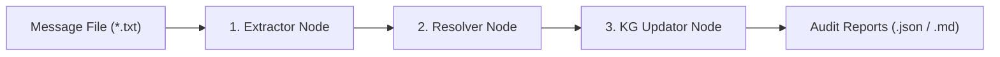

# Maritime Operational Message Loader (`MessageLoaderGraph`)

This module implements an idempotent, 3-node **LangGraph** pipeline that extracts, standardizes, resolves, and ingests unstructured operational communications (noon reports, port agent summaries, technical advisories, crew messages, customer inquiries) into the Neo4j Knowledge Graph.

---

## 1. Pipeline Architecture



### Node Responsibilities

1. **`extractor_node` (`nodes/extractor.py`)**:
   - Parses RFC email headers (`From`, `To`, `Date`, `Subject`).
   - Normalizes the `Date` header to standard ISO 8601 UTC.
   - Executes an LLM-based security scanner (`prompt_injection_detection` template) to detect adversarial prompt injection, jailbreaks, or instructions attempting to alter operational metrics.
   - Isolates the exact adversarial excerpt for quarantine.

2. **`entity_resolver_node` (`nodes/resolver.py`)**:
   - **Sender & Role Resolution**: Classifies the sender into maritime taxonomy (`Master's report`, `Agent email`, `Technical manager`, `Crew message`, `Customer`) and assigns a trust tier (`T1`–`T4`). Determines the appropriate sender edge (`SENT_BY_VESSEL`, `SENT_BY_ORG`, `ISSUED_BY_MANAGER`, `SENT_BY_CUSTOMER`).
   - **Maritime Entity Normalization**: Resolves unstructured mentions of vessels, ports, voyages, classes, and technical managers against the canonical maritime ontology, standardizing them into backtick-wrapped names (e.g. `` `MV Ocean Star` ``, `` `VG-0981` ``).
   - **Date & Temporal Resolution**: Normalizes local times and relative dates (e.g. "yesterday", "0130-1330 LT", "2 Aug") to UTC ISO 8601 strings based on message sent time and port timezones.
   - **Adversarial Excision**: Completely removes quarantined prompt injection text and delimiters from `cleaned_body`.

3. **`kg_updator_node` (`nodes/updator.py`)**:
   - **Programmatic Insertion**: Idempotently executes `MERGE (msg:Message {message_id: ...})` with `ON CREATE SET` and `ON MATCH SET`.
   - **Sender Relationship**: Idempotently establishes the sender edge to the corresponding node (`Organization`, `Vessel`, `TechnicalManager`, or `Customer`).
   - **ReAct Agent Execution**: Spawns an autonomous LangChain ReAct agent equipped with MCP tools (`execute_read_query`, `create_graph_nodes`, `update_graph_nodes`) to inspect existing graph context, corroborate or report incidents, update delay hours, and attach outgoing semantic relationships (`[:ABOUT_VOYAGE]`, `[:ABOUT_VESSEL]`, `[:CORROBORATES_INCIDENT]`, `[:REPORTS_INCIDENT]`, `[:REFERENCES_PORT]`, etc.).

---

## 2. Schema & Constraint Compliance

- **Uniqueness Constraint**: Enforces `unique_message_id` on `(:Message).message_id`.
- **Edge Properties**: All outgoing relationships attached to `Message` nodes strictly follow the schema constraint:
  - `temporal`: `"past"` | `"current"` | `"planned"`
  - `event_time_utc`: ISO 8601 UTC timestamp string (or `null` if unspecified)

---

## 3. Configuration & LLM Providers

Managed via `llm_factory.py` using `.env`:

```ini
LLM_PROVIDER=openrouter
OPENROUTER_API_KEY=sk-or-v1-...
OPENROUTER_MODEL=deepseek/deepseek-v4-flash-vision-exp
OPENROUTER_PROVIDER_NAME=deepinfra/fp8
OPENROUTER_MAX_TOKENS=4096
```

Supported providers:
- **OpenRouter** (`deepseek/deepseek-v4-flash-vision-exp` via `deepinfra/fp8`, `qwen/qwen3.8-27b`)
- **Groq** (`openai/gpt-oss-20b`)
- **Google Gemini** (`gemini-3.8-flash`)

Prompts are decoupled in [`prompts/message_loader_prompts.yaml`](file:///prompts/message_loader_prompts.yaml).

---

## 4. CLI Runner Usage

```powershell
# Ingest core directory (15 messages)
uv run python -m knowledge_graph.kg_loader.message_loader.runner --messages-dir synthetic_dataset/data/messages/core

# Ingest extra directory with skip-existing for incremental loads
uv run python -m knowledge_graph.kg_loader.message_loader.runner --messages-dir synthetic_dataset/data/messages/extra --skip-existing

# Ingest with limit
uv run python -m knowledge_graph.kg_loader.message_loader.runner --messages-dir synthetic_dataset/data/messages/core --limit 3
```

All runs produce structured JSON and Markdown audit reports in `ingestion_report_logs/`.

---

## 5. Tests

Unit tests covering header parsing, prompt injection detection, entity resolution, excision, and full graph execution:

```powershell
uv run python -m unittest tests/test_message_loader.py
```

